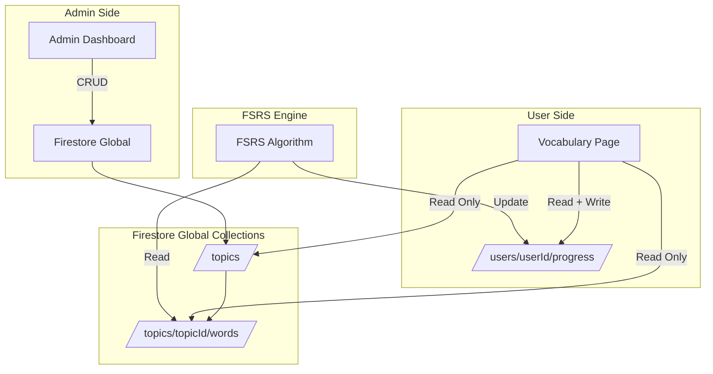

# Phương án quản lý nội dung từ vựng (Admin Content Management)

> Phân tích các phương án thực tế để admin quản lý topics, từ vựng cho LinguaFlash — dựa trên kinh nghiệm của các app học từ vựng thương mại.

---

## Bối cảnh hiện tại

- **Firestore structure**: `users/{userId}/folders` + `users/{userId}/cards` — mỗi user có data riêng biệt
- **Firestore rules**: Chỉ cho phép user đọc/ghi data của chính mình
- **Vấn đề**: Đã bỏ user-customizable folders → Admin cần cách quản lý topic + từ vựng cho toàn bộ users

---

## So sánh các app thương mại

| App | Cách quản lý nội dung | Mô hình |
|-----|----------------------|---------|
| **Duolingo** | Internal CMS + AI, team content chuyên nghiệp | Global content, user chỉ track progress |
| **Anki** | Community-driven shared decks + user tự tạo | Hybrid: shared + personal |
| **Memrise** | Admin tạo official courses + user tạo community courses | Global courses + user courses |
| **Quizlet** | User tạo sets, có verified teachers | User-generated, có curation |
| **ELSA Speak** | Internal CMS, AI-generated content | Global content only |
| **Drops** | Internal CMS, professionally curated | Global content only |

**Nhận xét chung**: Các app nghiêm túc đều dùng **Global Content** do admin/team tạo sẵn → user chỉ học và track tiến độ cá nhân.

---

## 3 Phương án cho LinguaFlash

### Phương án 1: Hardcode trong source code (JSON/JS files)

```
Cách hoạt động:
- Topics + từ vựng được định nghĩa trong file JS/JSON
- Mỗi lần cập nhật nội dung = commit code + deploy
- User data chỉ là tiến độ học tập - lưu trong Firestore
```

**Ưu điểm:**
- Đơn giản nhất, không cần backend thêm
- Nhanh load - không cần query Firestore cho nội dung
- Dễ version control - Git tracking mọi thay đổi
- Offline-first - content có sẵn trong app
- Không tốn Firestore reads cho content

**Nhược điểm:**
- Mỗi thay đổi nội dung = phải deploy lại app
- Không thể cập nhật content mà không cần developer
- File JS/JSON sẽ ngày càng lớn khi thêm nhiều từ

**Phù hợp khi:**
- Dự án 1 người / nhỏ
- Content ít thay đổi
- Muốn đơn giản nhất có thể

---

### Phương án 2: Firestore Global Collections + Admin Dashboard (⭐ KHUYẾN NGHỊ)

```
Cách hoạt động:
- Tạo Firestore global collections: /topics, /vocabularies
- Admin dashboard riêng để CRUD topics + từ vựng
- User data lưu ở users/{userId}/progress - chỉ track tiến độ
- Firestore rules: global collections = read-only cho user, write cho admin
```

**Kiến trúc Firestore mới:**

```
/topics/{topicId}
  ├── name: "Word Families: Go"
  ├── description: "Các từ liên quan đến go"
  ├── coverImage: "url..."
  ├── order: 1
  ├── category: "vocabulary"
  ├── level: "beginner"
  ├── wordCount: 15
  ├── tags: ["irregular-verbs", "movement"]
  └── createdAt, updatedAt

/topics/{topicId}/words/{wordId}
  ├── word: "go"
  ├── ipa: "/ɡoʊ/"
  ├── partOfSpeech: "verb"
  ├── meaning: "đi"
  ├── pastSimple: "went"
  ├── pastParticiple: "gone"
  ├── exampleSentence: "I {{go}} to school every day."
  ├── audioUrl: "..."
  ├── order: 1
  └── createdAt

/users/{userId}/progress/{wordId}
  ├── state: "review"          (FSRS state)
  ├── stability: 5.2
  ├── difficulty: 0.3
  ├── dueDate: timestamp
  ├── lastReview: timestamp
  ├── reps: 3
  ├── lapses: 0
  └── topicId: "topic123"
```

**Ưu điểm:**
- Chuẩn mực nhất - giống Duolingo, Memrise, Drops
- Admin cập nhật nội dung tức thì - không cần deploy
- Tách biệt rõ ràng: content vs user progress
- Scalable - thêm bao nhiêu topic/từ vựng cũng được
- Có thể cho nhiều admin quản lý
- Dễ A/B testing nội dung

**Nhược điểm:**
- Cần xây Admin Dashboard riêng
- Tốn thêm Firestore reads cho content
- Cần redesign Firestore rules
- Phức tạp hơn phương án 1

**Phù hợp khi:**
- Muốn app chuyên nghiệp, scalable
- Content thay đổi thường xuyên
- Có thể có nhiều admin/content editor sau này

---

### Phương án 3: Hybrid - JSON seed + Firestore sync

```
Cách hoạt động:
- Content ban đầu hardcode trong JSON files
- Admin page import/export JSON ↔ Firestore
- Có version tracking: app check version → auto-update content
```

**Ưu điểm:**
- Offline-first với JSON seed
- Có thể cập nhật remote qua Firestore
- Git vẫn tracking được content changes

**Nhược điểm:**
- Phức tạp nhất - phải sync 2 nguồn data
- Dễ conflict giữa local JSON và remote Firestore
- Over-engineering cho scale hiện tại

**Phù hợp khi:**
- App cần offline-first tuyệt đối
- Team lớn, content pipeline phức tạp

---

## So sánh tổng quan

| Tiêu chí | PA1: Hardcode | PA2: Firestore + Admin ⭐ | PA3: Hybrid |
|----------|:---:|:---:|:---:|
| Độ phức tạp | ⭐ Đơn giản | ⭐⭐ Vừa phải | ⭐⭐⭐ Phức tạp |
| Cập nhật content nhanh | ❌ Cần deploy | ✅ Tức thì | ✅ Tức thì |
| Offline support | ✅ Có sẵn | ⚠️ Cần cache | ✅ Có sẵn |
| Scalability | ⚠️ File lớn | ✅ Tốt | ✅ Tốt |
| Version control | ✅ Git | ⚠️ Firestore history | ✅ Git + Firestore |
| Chi phí Firestore | ✅ Thấp | ⚠️ Cao hơn | ⚠️ Trung bình |
| Cần developer để update | ✅ Có | ❌ Không | ❌ Không |
| Chuyên nghiệp | ⚠️ | ✅ | ✅ |

---

## Khuyến nghị: Phương án 2 (Firestore Global + Admin Dashboard)

### Lý do:

1. **Đúng chuẩn ngành** — tất cả app thương mại đều tách content khỏi source code
2. **Phù hợp với quyết định đã ra** — đã bỏ user-customizable folders → cần admin tool thay thế
3. **Firestore đã có sẵn** — chỉ cần thêm global collections + rules
4. **Không cần backend riêng** — Admin Dashboard là 1 trang web trong cùng app, check role admin
5. **Tương lai dễ mở rộng** — thêm content editor, categories, levels, search, analytics

### Admin Dashboard cần có:

1. **Topic Management** — CRUD topics, set order, cover image, tags
2. **Word Management** — CRUD từ vựng trong topic, set order, preview card
3. **Bulk Import** — Upload CSV/Excel để import hàng loạt từ vựng
4. **Preview** — Xem trước thẻ học giống user sẽ thấy
5. **Analytics** — Xem topic nào hot, từ nào user sai nhiều nhất

### Firestore Rules cập nhật:

```javascript
// Global content - ai cũng đọc được, chỉ admin ghi
match /topics/{topicId} {
  allow read: if request.auth != null;
  allow write: if request.auth != null 
    && get(/databases/$(database)/documents/users/$(request.auth.uid)).data.role == 'admin';
  
  match /words/{wordId} {
    allow read: if request.auth != null;
    allow write: if request.auth != null 
      && get(/databases/$(database)/documents/users/$(request.auth.uid)).data.role == 'admin';
  }
}

// User progress - mỗi user chỉ ghi của mình
match /users/{userId}/progress/{progressId} {
  allow read, write: if request.auth != null && request.auth.uid == userId;
}
```

### Migration plan:

```
Bước 1: Tạo global collections /topics + /topics/{id}/words
Bước 2: Cập nhật Firestore rules cho admin role
Bước 3: Thêm role field vào user profile
Bước 4: Xây Admin Dashboard pages
Bước 5: Migrate vocabulary page để đọc từ global topics
Bước 6: Tạo progress tracking system thay cho cards subcollection
```

---

## Sơ đồ kiến trúc



---

## Tóm tắt

Phương án 2 là lựa chọn tốt nhất cho LinguaFlash vì:
- **Tách biệt** nội dung và tiến độ user
- **Admin Dashboard** cho phép cập nhật không cần deploy  
- **Firestore rules** kiểm soát quyền admin vs user
- **Chuẩn ngành** — giống cách Duolingo, Memrise hoạt động
- **Tận dụng** Firestore infrastructure đã có sẵn
