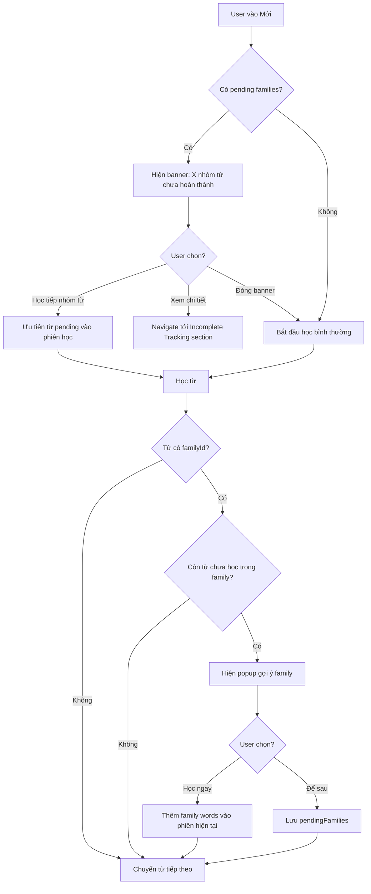

# Family Word Learning Flow - Thiết kế luồng học nhóm từ

## Tổng quan

Khi người dùng học 1 từ mới, hệ thống gợi ý học tiếp các từ cùng họ, dạng bất quy tắc. Không ép buộc — chỉ gợi ý thông minh + khu vực thống kê tiến trình dở dang.

---

## 0. QUY TẮC NHÓM FAMILY WORD (BẮT BUỘC)

> ⚠️ Đọc kỹ trước khi gán `familyId` cho bất kỳ từ nào trong seed. Quy tắc này
> là nguồn chân lý cho cách [`FamilyWordManager`](../packages/english/src/utils/family-word-manager.js)
> gom nhóm và gợi ý học.

### 0.1. Định nghĩa: Family word là gì

Một **family word** (nhóm từ cùng họ) là tập các từ **phái sinh từ CÙNG MỘT GỐC
TỪ** bằng cách biến đổi đuôi / thêm tiền tố hậu tố (derivational morphology).
Chúng chia sẻ một **gốc chung (stem)** nhìn thấy được ở dạng chữ viết.

**✅ ĐÚNG là family word:**

```
beauty → beautify → beautiful → beautifully   (gốc "beaut")
art → artist → artistic → artwork              (gốc "art")
educate → education → educational → educator   (gốc "educat")
happy → happily → happiness → unhappy          (gốc "happ")
```

**❌ KHÔNG phải family word** (dù cùng chủ đề ngữ nghĩa):

```
fat, protein, fiber, calorie, vitamin   → cùng chủ đề "dinh dưỡng" nhưng KHÁC GỐC
breakfast, lunch, dinner, snack          → cùng chủ đề "bữa ăn" nhưng KHÁC GỐC
beef, pork, chicken, seafood             → cùng chủ đề "thịt" nhưng KHÁC GỐC
```

> Sai lầm thường gặp: dùng `familyId` như "nhãn chủ đề" (topic label) để gom các
> từ liên quan về nghĩa. KHÔNG được làm vậy. Chủ đề đã được thể hiện qua chính
> topic/folder của từ. `familyId` CHỈ dành cho họ từ phái sinh cùng gốc.

### 0.2. Tiêu chí kỹ thuật để 2 từ "cùng họ"

Hai từ thuộc cùng một family khi và chỉ khi tiền tố chung dài nhất (Longest
Common Prefix - LCP) của chúng thoả mãn ĐỒNG THỜI:

1. **LCP ≥ 3 ký tự** (`MIN_STEM_LEN`), và
2. **LCP ≥ 50% độ dài từ ngắn hơn** (`MIN_STEM_RATIO`).

| Cặp từ | LCP | Từ ngắn hơn | Tỉ lệ | Kết luận |
|--------|-----|-------------|-------|----------|
| art / artist | 3 (`art`) | 3 | 100% | ✅ cùng họ |
| educate / education | 6 (`educat`) | 7 | 86% | ✅ cùng họ |
| calorie / calcium | 3 (`cal`) | 7 | 43% | ❌ trùng tiền tố tình cờ |
| fat / fiber | 1 (`f`) | 3 | 33% | ❌ khác gốc |

> Điều kiện (2) loại bỏ trường hợp trùng tiền tố ngẫu nhiên (calorie/calcium).

### 0.3. Cơ chế xác thực tự động (runtime)

[`FamilyWordManager`](../packages/english/src/utils/family-word-manager.js) KHÔNG
tin tuyệt đối vào `familyId` từ seed. Trong từng `familyId`, nó:

1. Gom cụm các từ bằng **union-find** dựa trên tiêu chí 0.2 (hàm `_clusterFamilyCards`).
2. Mỗi cụm có **≥ 2 từ cùng gốc** mới được coi là family thật → mới gợi ý học.
3. Từ lẻ (không có từ nào cùng gốc trong family) bị loại khỏi gợi ý family.
4. `rawKey` của family là `"${familyId}|${stem}"` (stem = LCP của cả cụm), nên một
   `familyId` chứa nhiều gốc khác nhau sẽ tách thành nhiều nhóm độc lập.

Hệ quả: kể cả khi seed lỡ gán `familyId: "nutrition"` cho fat/protein/fiber, hệ
thống vẫn KHÔNG gợi ý chúng như một family vì không có ≥ 2 từ cùng gốc.

### 0.4. Hướng dẫn gán familyId trong seed

- Chỉ gán cùng `familyId` cho các từ THỰC SỰ cùng gốc phái sinh.
- Đặt tên `familyId` theo gốc từ, VD `educate`, `art`, `beauty` (không đặt theo
  chủ đề như `nutrition`, `meal-types`).
- `familyOrder`: 1 = từ gốc, 2,3... = các biến thể (thứ tự học).
- Từ đơn lẻ không có biến thể cùng gốc trong topic → để `familyId` rỗng/null.
- Không bắt buộc tách file; nhiều cụm gốc khác nhau có thể vô tình trùng
  `familyId` — runtime vẫn tách đúng nhờ 0.3, nhưng nên đặt đúng để dữ liệu sạch.

---

## 1. Cấu trúc dữ liệu

### Trường bổ sung trong mỗi từ vựng

```
familyId: string | null    -- Gốc từ chung, VD: "educate" (xem mục 0 về quy tắc)
familyOrder: number | null -- Thứ tự học trong family: 1 = gốc, 2,3... = biến thể
tags: string[]             -- ["idiom", "phrasal-verb", "irregular-verb", "irregular-adjective", "irregular-adverb"]
```

### Ví dụ nhóm family

```
familyId: "educate"
  1. educate (verb) → từ gốc
  2. education (noun)
  3. educational (adjective)
  4. educator (noun)

familyId: "good"
  1. good (adj, irregular) → comparative: better, superlative: best
  2. goodness (noun)

familyId: null → từ đơn lẻ, không thuộc family nào
```

> Lưu ý: gán `familyId` phải tuân theo **mục 0**. `familyId` không phải nhãn chủ đề.

---

## 2. Luồng học - Gợi ý Family Word

### Bước 1: Học xong từ gốc

Sau khi user gõ đúng từ gốc, VD "educate":

### Bước 2: Hiển thị popup gợi ý

```
┌─────────────────────────────────────────┐
│ 📖 Nhóm từ cùng họ                      │
│                                         │
│ Từ "educate" có 3 từ liên quan:         │
│                                         │
│  📝 education (n) — sự giáo dục        │
│  📝 educational (adj) — mang tính GD    │
│  📝 educator (n) — nhà giáo dục        │
│                                         │
│  [Học ngay]          [Để sau]           │
└─────────────────────────────────────────┘
```

### Bước 3a: User chọn "Học ngay"
- Hệ thống thêm 3 từ vào phiên học hiện tại, xếp ngay sau
- Thanh progress cập nhật số lượng

### Bước 3b: User chọn "Để sau"
- Lưu vào `pendingFamilies` trong user progress
- Từ family sẽ được ưu tiên ở phiên học tiếp theo
- Popup KHÔNG hiện lại cho cùng family này

---

## 3. Thông báo khi có nhiều family dở dang

### Quy tắc: Chỉ hiện 1 banner duy nhất khi vào phiên học

Khi user mở trang Mới và có >= 1 pending family:

```
┌─────────────────────────────────────────────────┐
│ 💡 Bạn có 3 nhóm từ chưa hoàn thành             │
│    educate (2/4) · improve (1/3) · good (0/2)   │
│                                                  │
│  [Học tiếp nhóm từ]    [Xem chi tiết]   [✕]    │
└─────────────────────────────────────────────────┘
```

- Nhấn "Học tiếp nhóm từ" → ưu tiên học các từ pending trước
- Nhấn "Xem chi tiết" → navigate tới khu vực thống kê
- Nhấn ✕ → ẩn banner, phiên này không hiện lại
- Banner chỉ hiện 1 lần mỗi phiên học, không spam

---

## 4. Khu vực thống kê - Incomplete Tracking

### Vị trí: Section mới trên trang Vocabulary, giữa Action Buttons và Topic Grid

```
┌─────────────────────────────────────────────────┐
│ ⏳ Nhóm từ chưa hoàn thành (5)                  │
│                                                  │
│ ┌──────────────────┐ ┌──────────────────┐       │
│ │ educate          │ │ improve          │       │
│ │ ██████░░ 2/4     │ │ ████░░░░ 1/3     │       │
│ │ education ✅     │ │ improvement 🆕   │       │
│ │ educational 🆕   │ │ improvable 🆕    │       │
│ │ educator 🆕      │ │                  │       │
│ │ [Học tiếp]       │ │ [Học tiếp]       │       │
│ └──────────────────┘ └──────────────────┘       │
│                                                  │
│ ┌──────────────────┐ ┌──────────────────┐       │
│ │ 🔀 ĐTBQT dở     │ │ 🔀 TT/TrT BQT   │       │
│ │ go: went/gone 🆕 │ │ good: better 🆕  │       │
│ │ eat: ate/? 🆕    │ │ bad: worse 🆕    │       │
│ │ [Học tiếp]       │ │ [Học tiếp]       │       │
│ └──────────────────┘ └──────────────────┘       │
│                                                  │
│ Section ẩn khi không có nhóm từ dở dang nào     │
└─────────────────────────────────────────────────┘
```

### Phân loại trong khu vực thống kê

| Tab/Section | Nội dung | Điều kiện hiển thị |
|---|---|---|
| Family Words | Các nhóm familyId có >= 1 từ đã học và >= 1 từ chưa học | familyId != null AND có mix trạng thái |
| Động từ BQT | Từ có tag irregular-verb mà user đã học từ gốc nhưng chưa học V2/V3 | tags includes irregular-verb |
| Tính từ/Trạng từ BQT | Từ có tag irregular-adjective/adverb mà chưa học comparative/superlative | tags includes irregular-adjective hoặc irregular-adverb |

### Nút "Học tiếp"
- Nhấn vào → thêm các từ chưa học của nhóm đó vào phiên học
- Sau khi học xong → nhóm biến mất khỏi khu vực thống kê
- Nếu tất cả nhóm hoàn thành → toàn bộ section ẩn đi

---

## 5. Lưu trữ Progress

### Trong user progress - localStorage + Firestore sync

```json
{
  "pendingFamilies": {
    "educate": {
      "learnedWords": ["educate", "education"],
      "totalWords": 4,
      "addedAt": "2026-04-16T03:00:00Z",
      "dismissed": false
    },
    "good": {
      "learnedWords": ["good"],
      "totalWords": 2,
      "addedAt": "2026-04-16T03:05:00Z",
      "dismissed": false
    }
  }
}
```

### Logic cập nhật
- Khi học xong 1 từ → kiểm tra familyId
  - Nếu familyId != null → thêm/update pendingFamilies
  - Nếu tất cả từ trong family đã học → xóa khỏi pendingFamilies
- `dismissed: true` → không hiện popup gợi ý, nhưng vẫn hiện trong khu vực thống kê

---

## 6. Luồng tổng thể



---

## 7. Todo list triển khai

1. Cập nhật data model - thêm familyId, familyOrder, tags vào vocabulary data
2. Tạo module FamilyWordManager xử lý logic pending families
3. Sửa Study page - thêm popup gợi ý sau khi học xong từ có family
4. Sửa Study page - thêm banner nhắc nhở pending families
5. Tạo Incomplete Tracking section trên trang Vocabulary
6. Lưu trữ pendingFamilies trong localStorage + Firestore sync
7. CSS cho popup, banner, tracking section
