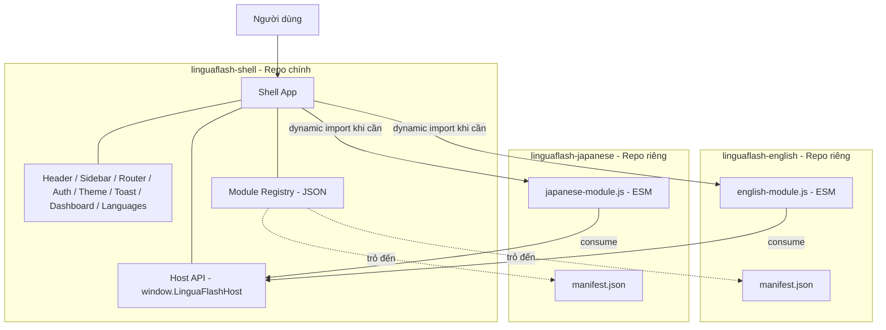
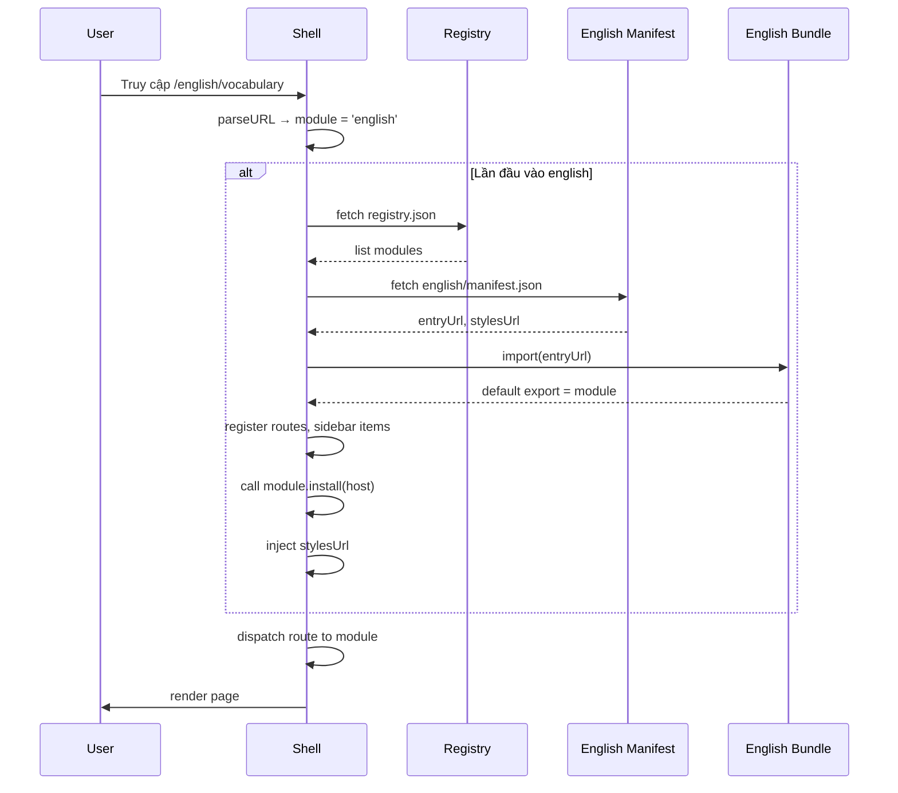

# 🏗️ Quy hoạch Kiến trúc Micro-frontend cho LinguaFlash

> **Mục tiêu**: Chuyển LinguaFlash từ monolith sang micro-frontend, mỗi ngôn ngữ là một module/repo độc lập, có thể phát triển và deploy riêng mà không ảnh hưởng đến các ngôn ngữ khác.

---

## 1. Hiện trạng (Monolith)

### 1.1 Cấu trúc code
- Vanilla JS, không bundler. Tất cả file load qua `<script>` trong [`public/index.html`](../public/index.html:131).
- Mọi module ở **global scope**: `Router`, `Sidebar`, `VocabularyPage`, `GrammarPage`, `FirestoreDB`...
- Sidebar items được hardcode trong [`public/src/js/ui/sidebar.js`](../public/src/js/ui/sidebar.js:20).
- Routes register tập trung trong [`public/src/js/app.js`](../public/src/js/app.js:64).
- Code Tiếng Anh (vocabulary, grammar, topics, fields) trộn lẫn với code shared (auth, FSRS, sidebar, theme...).

### 1.2 Vấn đề
| # | Vấn đề | Tác động |
|---|--------|----------|
| 1 | Sidebar luôn hiện tất cả menu items | Khi ở `/languages`, vẫn thấy "Từ vựng / Ngữ pháp" của tiếng Anh — UX rối |
| 2 | Code tiếng Anh và core trộn lẫn | Mọi thay đổi (kể cả thêm tiếng Nhật) đều có nguy cơ break tiếng Anh |
| 3 | Monolith deploy: 1 build → 1 hosting | Không thể chỉ deploy "module tiếng Nhật" |
| 4 | Repo sẽ phình to khi thêm ngôn ngữ | Hiện đã ~3000 dòng vocabulary.js, ~25 file seed JSON |
| 5 | Data Firestore không phân biệt ngôn ngữ | Card không có `languageId` → khó query đúng theo ngôn ngữ active |

---

## 2. Kiến trúc Mục tiêu

### 2.1 Khái niệm



### 2.2 Trách nhiệm các thành phần

#### Shell App (linguaflash-shell)
- **Bootstrap**: load Firebase, Auth, Theme, Toast
- **Layout**: Header, Sidebar (động), main-content slot
- **Routing core**: parse URL, dispatch tới shell page hoặc tới module ngôn ngữ
- **Host API** (`window.LinguaFlashHost`): expose shared services cho modules
- **Module loader**: fetch registry, dynamic `import()` module bundle, install/uninstall
- **Shell-only pages**: Dashboard (`/`), Languages (`/languages`), Settings, Account, Auth

#### Language Module (e.g. linguaflash-english)
- **Tự chứa**: tất cả pages, components, data seed, CSS riêng của ngôn ngữ
- **Manifest**: khai báo metadata + URL của entry bundle
- **Entry bundle** (1 file ESM duy nhất): export một object theo Module Contract
- **Không bao giờ truy cập Firebase trực tiếp** → luôn qua Host API

### 2.3 URL Convention

| Path | Owner | Mô tả |
|------|-------|-------|
| `/` | Shell | Dashboard |
| `/auth` | Shell | Đăng nhập |
| `/languages` | Shell | Trang chọn ngôn ngữ |
| `/settings`, `/account` | Shell | Cài đặt, tài khoản |
| `/english/*` | English module | Mọi route của module Tiếng Anh |
| `/japanese/*` | Japanese module | Mọi route của module Tiếng Nhật |

→ Shell nhìn segment đầu sau `/` để biết module nào cần load.

---

## 3. Module Contract

Mỗi language module export một object theo schema sau:

```js
// english-module.js (ES Module)
export default {
  // Định danh
  id: 'english',
  version: '1.0.0',

  // Hiển thị trên trang chọn ngôn ngữ
  meta: {
    name: 'Tiếng Anh',
    nameNative: 'English',
    flagLabel: 'EN',
    icon: 'translate',
    color: '#3B82F6',
    colorGradient: 'linear-gradient(135deg, #3B82F6 0%, #2563EB 100%)',
    description: 'Học từ vựng, ngữ pháp và giao tiếp tiếng Anh'
  },

  // URL prefix mà module này quản lý
  basePath: '/english',

  // Route entry mặc định khi user click vào module từ trang Languages
  defaultRoute: '/english/vocabulary',

  // Sidebar items (chỉ hiện khi module này active)
  sidebarItems: [
    { id: 'en-vocab', icon: 'menu_book', label: 'Từ vựng', route: '/english/vocabulary' },
    { id: 'en-grammar', icon: 'school', label: 'Ngữ pháp', route: '/english/grammar' }
  ],

  // Routes — page object có shape giống pattern hiện tại { render, onEnter, onLeave }
  routes: [
    { path: '/english/vocabulary', page: VocabularyPage },
    { path: '/english/grammar', page: GrammarPage },
    { path: '/english/topic/:id', page: TopicDetailPage },
    { path: '/english/study', page: StudyPage },
    { path: '/english/review', page: ReviewPage }
  ],

  // Lifecycle hooks
  async install(host) {
    // host = window.LinguaFlashHost
    // - Inject CSS riêng của module (host.injectStyle(url))
    // - Khởi tạo state nội bộ
    // - Đăng ký event listeners nếu cần
  },

  async uninstall() {
    // - Cleanup khi user chuyển ngôn ngữ khác
    // - Remove CSS, clear timers, abort fetches
  }
};
```

---

## 4. Host API (`window.LinguaFlashHost`)

API mà shell expose ra cho modules. Đây là "contract" cố định, version-stable.

```js
window.LinguaFlashHost = {
  version: '1.0.0',

  // Auth
  auth: {
    isSignedIn(): boolean,
    getUserId(): string | null,
    onAuthChange(handler): unsubscribe
  },

  // Data — abstraction trên Firestore, ép module phải qua đây
  data: {
    // Tất cả query đều tự động scope theo languageId của module gọi
    getCards(filter): Promise<Card[]>,
    getCard(id): Promise<Card | null>,
    saveCard(card): Promise<string>,
    deleteCard(id): Promise<void>,
    getDueCards(filter): Promise<Card[]>,
    // ... folders, sessions
  },

  // Routing
  router: {
    navigate(path): void,
    getPath(): string,
    getParams(): object
  },

  // UI
  ui: {
    toast: { success, error, info, warning },
    showModal(opts): Promise<result>,
    setPageTitle(title): void,
    injectStyle(url): styleHandle,
    removeStyle(handle): void
  },

  // FSRS engine (shared algorithm)
  fsrs: {
    createCard(): Card,
    review(card, rating): Card,
    State: { NEW, LEARNING, REVIEW, RELEARNING }
  },

  // TTS, helpers
  tts: { speak(text, lang): void },
  helpers: { sleep, debounce, ... }
};
```

**Nguyên tắc**: Module **chỉ** giao tiếp với shell qua API này. Không truy cập `firebase`, `db`, `Auth.*` trực tiếp. Đây là contract cho phép shell thay implementation (ví dụ chuyển từ Firebase sang Supabase) mà module không cần đổi.

---

## 5. Module Registry & Loading

### 5.1 Registry

Một file JSON đơn giản (deploy cùng shell hoặc fetch từ remote):

```json
{
  "version": "1.0.0",
  "modules": [
    {
      "id": "english",
      "name": "Tiếng Anh",
      "manifestUrl": "https://english.linguaflash.app/manifest.json",
      "available": true,
      "minHostVersion": "1.0.0"
    },
    {
      "id": "japanese",
      "name": "Tiếng Nhật",
      "manifestUrl": "https://japanese.linguaflash.app/manifest.json",
      "available": false,
      "minHostVersion": "1.0.0"
    }
  ]
}
```

### 5.2 Manifest của module

```json
{
  "id": "english",
  "version": "1.2.3",
  "name": "Tiếng Anh",
  "entryUrl": "https://english.linguaflash.app/dist/english-module-1.2.3.js",
  "stylesUrl": "https://english.linguaflash.app/dist/english-module-1.2.3.css",
  "minHostVersion": "1.0.0",
  "checksum": "sha384-..."
}
```

### 5.3 Loading flow



### 5.4 Switching language

Khi user vào `/japanese/vocabulary`:
1. Shell phát hiện active module đổi từ `english` → `japanese`
2. Gọi `english.uninstall()` (cleanup CSS, listeners)
3. Load `japanese` module nếu chưa load
4. Gọi `japanese.install(host)`
5. Sidebar re-render với items của japanese
6. Dispatch route

---

## 6. Data Isolation (Firestore)

### 6.1 Vấn đề hiện tại
Card hiện không có `languageId`. Nếu thêm tiếng Nhật, query `getCards({ cardType: 'vocabulary' })` sẽ trộn cả 2 ngôn ngữ.

### 6.2 Giải pháp: thêm `languageId`

**Schema mới**:
```
users/{uid}/cards/{cardId}
{
  languageId: 'english',     // ← MỚI
  cardType: 'vocabulary',
  fieldValues: { ... },
  ...
}

users/{uid}/folders/{folderId}
{
  languageId: 'english',     // ← MỚI
  ...
}
```

**Host API tự động scope**:
```js
// Trong shell, khi module 'english' gọi:
host.data.getCards({ cardType: 'vocabulary' })

// Shell tự thêm filter languageId='english' phía sau
// → query: where('languageId','==','english').where('cardType','==','vocabulary')
```

→ Module không cần biết về `languageId`. Shell tự inject. Đảm bảo module không "vô tình" đọc data của ngôn ngữ khác.

### 6.3 Migration
Script migration: với mọi card hiện có → set `languageId = 'english'`. Chạy 1 lần khi user lần đầu mở phiên bản mới.

### 6.4 Firestore Security Rules
```
match /users/{uid}/cards/{cardId} {
  allow read, write: if request.auth.uid == uid;
  // (Không cần rule riêng cho languageId — đã thuộc user)
}
```

---

## 7. Build & Deploy

### 7.1 Bundler: Vite

Chọn Vite vì:
- Cấu hình tối thiểu, dev server cực nhanh
- Build ra ESM thuần, phù hợp với dynamic `import()`
- Plugin ecosystem đủ tốt
- Không khác biệt mental model nhiều với vanilla JS hiện tại

### 7.2 Cấu trúc mỗi repo

**linguaflash-shell**:
```
linguaflash-shell/
├── package.json
├── vite.config.js
├── public/
│   ├── icons/...
│   └── manifest.json (PWA)
├── src/
│   ├── main.js               # Entry — bootstrap shell
│   ├── host-api.js           # Define & expose window.LinguaFlashHost
│   ├── module-loader.js      # Load remote modules
│   ├── shell/
│   │   ├── router.js
│   │   ├── sidebar.js        # Sidebar with dynamic items
│   │   ├── auth/
│   │   ├── db/firestore.js   # Wrapped, auto-scope by languageId
│   │   ├── fsrs/
│   │   ├── ui/{toast,theme,components,...}
│   │   └── pages/
│   │       ├── home.js       # Dashboard
│   │       ├── languages.js  # Trang chọn ngôn ngữ
│   │       ├── settings.js
│   │       ├── account.js
│   │       └── auth-page.js
│   └── modules-registry.json
├── index.html
└── firebase.json (deploy ra linguaflash.app)
```

**linguaflash-english**:
```
linguaflash-english/
├── package.json
├── vite.config.js              # Build mode: 'lib', output ESM
├── public/
│   └── seed-vocabulary/...     # Seed JSON files
├── src/
│   ├── index.js                # Module entry — export default {...}
│   ├── pages/
│   │   ├── vocabulary.js
│   │   ├── grammar.js
│   │   ├── topic-detail.js
│   │   ├── study.js
│   │   └── review.js
│   ├── config/
│   │   ├── card-schemas.js     # Vocabulary/Grammar schema riêng EN
│   │   └── vocabulary-topics.js
│   ├── ui/{folder-tree, card-filter,...}
│   ├── utils/{family-word-manager, seed-importer, tts, ...}
│   └── styles/english.css
└── firebase.json (deploy ra english.linguaflash.app)
```

### 7.3 Vite config cho module

```js
// vite.config.js của linguaflash-english
export default {
  build: {
    lib: {
      entry: 'src/index.js',
      formats: ['es'],
      fileName: () => 'english-module.js'
    },
    rollupOptions: {
      // Không bundle các thứ shell đã có (firebase chỉ load ở shell)
      external: []
    }
  }
};
```

### 7.4 Deploy strategy

| Component | Hosting | URL |
|-----------|---------|-----|
| Shell | Firebase Hosting site `linguaflash` | `linguaflash.app` |
| English module | Firebase Hosting site `linguaflash-english` | `english.linguaflash.app` |
| Japanese module | Firebase Hosting site `linguaflash-japanese` | `japanese.linguaflash.app` |

Firebase cho phép nhiều **hosting sites** trong 1 project (`firebase target:apply hosting <name>`). Mỗi site = 1 deploy độc lập.

**CORS**: Shell cần fetch manifest và import bundle từ `english.linguaflash.app`. Bật CORS cho các site module.

**Versioning**: Module có thể giữ nhiều version (`english-module-1.2.3.js`, `english-module-1.3.0.js`). Registry trỏ đến version stable. Có thể rollback bằng cách đổi `entryUrl` trong manifest.

### 7.5 Caching & PWA
- Shell: Service Worker cache shell shell + critical CSS
- Module: cache theo URL có version → bundle mới = URL mới = cache miss = fetch mới (không invalidate manually)
- Headers: `Cache-Control: public, max-age=31536000, immutable` cho `*-module-{version}.js`

---

## 8. Sidebar Architecture (giải quyết vấn đề UX)

### 8.1 State

```js
// Trong shell
const SidebarState = {
  activeLanguageId: null,   // null khi ở dashboard/languages page
  globalItems: [
    { id: 'home', icon: 'home', label: 'Trang chủ', route: '/' }
  ],
  globalFooterItems: [
    { id: 'languages', icon: 'language', label: 'Chọn ngôn ngữ', route: '/languages' }
  ],
  languageItems: []  // do module active đăng ký
};
```

### 8.2 Logic render

```
function renderSidebar() {
  const items = [];
  items.push(...SidebarState.globalItems);
  if (SidebarState.activeLanguageId) {
    items.push({ type: 'divider' });
    items.push(...SidebarState.languageItems);
  }
  // footer luôn render
  // ...
}
```

### 8.3 Khi nào set activeLanguageId
- Route đổi → shell parse URL
- Nếu URL = `/`, `/languages`, `/auth`, `/settings` → `activeLanguageId = null`
- Nếu URL = `/english/*` → `activeLanguageId = 'english'`, load module nếu chưa
- Nếu URL = `/japanese/*` → uninstall english, install japanese

### 8.4 Mockup

**Khi ở `/languages`** (chưa chọn ngôn ngữ):
```
┌──────────────┐
│ 🏠 Trang chủ │
├──────────────┤
│ 🌐 Chọn ngôn │  ← active
│    ngữ       │
└──────────────┘
```

**Khi ở `/english/vocabulary`**:
```
┌──────────────┐
│ 🏠 Trang chủ │
├──────────────┤
│ 📖 Từ vựng   │  ← active (do English module register)
│ 🎓 Ngữ pháp  │
│ 👂 Luyện CT  │
├──────────────┤
│ 🌐 Chọn ngôn │
│    ngữ       │
└──────────────┘
```

**Khi ở `/japanese/hiragana`**:
```
┌──────────────┐
│ 🏠 Trang chủ │
├──────────────┤
│ あ Hiragana  │  ← do Japanese module register
│ カ Katakana  │
│ 漢 Kanji     │
├──────────────┤
│ 🌐 Chọn ngôn │
│    ngữ       │
└──────────────┘
```

---

## 9. Lộ trình chuyển đổi (Phased Migration)

Việc tái cấu trúc lớn không nên làm "big bang". Chia 4 giai đoạn, mỗi giai đoạn shippable độc lập:

### **Phase 1: Fix UX sidebar + Định nghĩa scope (không đổi kiến trúc)**

Mục tiêu: giải quyết ngay vấn đề bạn nêu. Vẫn monolith.

- Refactor [`sidebar.js`](../public/src/js/ui/sidebar.js:1) thành state-based: `globalItems` + `languageItems` + `activeLanguageId`
- Đổi URL convention: `/vocabulary` → `/english/vocabulary`, `/grammar` → `/english/grammar`, etc. (giữ redirect cho URL cũ trong 1-2 phiên bản)
- Trang `/languages` set `activeLanguageId = null` → sidebar chỉ hiện global items
- Trang `/english/*` set `activeLanguageId = 'english'` → hiện language items

**Kết quả**: UX đúng, code đã sẵn sàng cho Phase 2.

### **Phase 2: Module hóa code Tiếng Anh trong cùng repo**

Mục tiêu: tách logic English vào folder riêng, định hình Module Contract, vẫn cùng repo + cùng deploy.

- Tạo folder `public/src/js/modules/english/` chứa: pages, config, ui-components, utils thuần English
- Giữ lại `public/src/js/shell/` cho shared: auth, fsrs, db, theme, sidebar core
- Định nghĩa `LinguaFlashHost` API trong shell
- English module truy cập Firestore qua `LinguaFlashHost.data.*` thay vì `FirestoreDB.*`
- Cards của user được migration script set `languageId = 'english'`

**Kết quả**: Code English đã isolation về mặt logic, dễ dàng tách repo sau này. Vẫn 1 deploy.

### **Phase 3: Thêm Vite + Lazy load module**

Mục tiêu: bundler hóa, module tải động, cùng repo (monorepo pnpm workspace).

- Setup pnpm workspace với 2 package: `shell` và `english`
- Vite cho cả shell và english module (build lib mode)
- Shell động `import('./english/dist/english-module.js')` khi vào `/english/*`
- Code splitting đúng đắn — vào dashboard không tải bundle English

**Kết quả**: Module thực sự lazy-load. Bundle dashboard nhỏ. Vẫn 1 repo, 1 deploy.

### **Phase 4: Tách repo + Deploy độc lập**

Mục tiêu: hiện thực hóa yêu cầu cuối cùng — repo riêng, deploy riêng.

- Tách `english/` thành repo `linguaflash-english`
- Setup Firebase hosting site riêng cho mỗi module
- Shell fetch registry + manifest, dynamic import từ URL remote
- Setup CORS, CSP cho cross-origin module loading
- CI/CD riêng cho mỗi repo

**Kết quả**: Đạt yêu cầu hoàn toàn. Sau Phase 4, thêm tiếng Nhật = tạo repo `linguaflash-japanese`, không động vào English hay Shell.

---

## 10. Rủi ro và Mitigation

| Rủi ro | Mức | Mitigation |
|--------|-----|------------|
| Host API breaking change phá module | Cao | Versioning rõ ràng, `module.minHostVersion` check trước khi load |
| Module remote bị crash/timeout | Trung | Loading timeout + fallback UI "Module không tải được, chọn ngôn ngữ khác" |
| CORS/CSP cấu hình sai | Trung | Test sandbox env trước, dùng wildcard cho subdomain `*.linguaflash.app` |
| Cache stale giữa shell và module | Trung | Versioned URL: `english-module-1.2.3.js`. Đổi version = đổi URL = no stale |
| Shared dependency duplicate (Firebase load 2 lần) | Cao | Firebase **chỉ** load ở shell, expose qua Host API. Module không bao giờ import firebase |
| User offline không load được module remote | Trung | Service Worker cache module bundle sau lần load đầu |
| Migration `languageId` bỏ sót card cũ | Trung | Defensive: query không có languageId = treat as 'english' (default) |
| Phase 1 đổi URL phá link bookmark cũ | Thấp | Redirect rules: `/vocabulary` → `/english/vocabulary` (giữ 6 tháng) |

---

## 10b. Dashboard Strategy (Hybrid 2 tầng)

### Vấn đề
- Dashboard hiện tại hiển thị streak/practice/heatmap — lấy từ `studySessions`, đã global (không filter theo cardType hay ngôn ngữ).
- Khi có nhiều ngôn ngữ: muốn streak chung (motivation) nhưng cũng cần thấy tiến trình từng ngôn ngữ.

### Quyết định: Hybrid 2 tầng

#### Tầng 1 — Dashboard Global (`/`) — thuộc Shell

| Metric | Scope | Nguồn |
|--------|-------|-------|
| Streak | Global | `studySessions` — count ngày có study |
| Practice time hôm nay | Global | `studySessions` — sum minutes |
| Heatmap | Global | `studySessions` theo năm |
| Summary card mỗi ngôn ngữ | Per language | `cards` group by `languageId`: total / dueCount / newCount |

Mockup:
```
+---------------------------------------------------+
|  Chao mung tro lai!                               |
+------------------------+--------------------------+
|  Streak: 12 ngay       |  Thoi gian: 2h 15m      |
+------------------------+--------------------------+
|  Heatmap nam 2026 - tong tat ca ngon ngu          |
+---------------------------------------------------+
|  Tien trinh theo ngon ngu                         |
|  +------------------+  +------------------+       |
|  | EN  Tieng Anh    |  | JP  Tieng Nhat   |       |
|  | 320 the          |  | 45 the           |       |
|  | 8 can on         |  | 3 can on         |       |
|  | ->               |  | ->               |       |
|  +------------------+  +------------------+       |
+---------------------------------------------------+
```

Click vao summary card -> navigate vao `module.defaultRoute`.

#### Tầng 2 — Landing page riêng module (tuỳ chọn)

Module có thể (không bắt buộc) định nghĩa route `/english`, `/japanese` làm landing với metrics đặc thù. Nếu không có, `defaultRoute` đưa thẳng user vào page chính.

Ví dụ:
- English: `defaultRoute: '/english/vocabulary'` — không cần landing riêng vì Vocabulary/Grammar đã có stats chi tiết
- Japanese: `defaultRoute: '/japanese'` — có landing riêng với JLPT progress, Kanji level...

### Cách shell lấy summary mà không cần load module

```js
// Trong shell DashboardPage
async function loadLanguageSummaries() {
  const allCards = await db.collection('users/' + uid + '/cards').get();
  const byLang = groupBy(allCards, c => c.languageId || 'english');
  
  return registry.modules
    .filter(m => m.available)
    .map(m => ({
      ...m.meta,
      defaultRoute: m.defaultRoute,
      total: byLang[m.id]?.length || 0,
      newCount: countNew(byLang[m.id]),
      dueCount: countDue(byLang[m.id])
    }));
}
```

Shell **không cần load module bundle** để hiển thị summary. Lazy-load vẫn đảm bảo. Shell chỉ biết về core schema `{ languageId, state, dueDate }` — đây là shared contract.

### Trade-off đã chấp nhận
- Shell biết về schema `cards` ở mức core (languageId, state, dueDate, cardType). Đây là shared schema — versioning bắt buộc.
- Module muốn hiển thị metric đặc thù (vd: Kanji level) -> để dành cho landing page Tầng 2 hoặc các page con của module.

---

## 11. Câu hỏi mở cần quyết

1. **Hosting sub-domain hay sub-path?**
   - `english.linguaflash.app` (subdomain — cleanest, cần CORS) — **đề xuất**
   - `linguaflash.app/modules/english/` (subpath — không cần CORS, nhưng bị buộc cùng Firebase project hosting)

2. **Registry static hay dynamic?**
   - Static JSON deploy cùng shell (đơn giản, nhưng update registry = redeploy shell) — **đề xuất giai đoạn đầu**
   - Firestore document `app/registry` (admin update real-time, không cần redeploy)

3. **Mỗi module có quyền tự đăng ký lên registry không?**
   - Hiện tại: registry do shell maintain (whitelist) — **đề xuất**
   - Sau này có thể mở: third-party tự submit module

4. **Tên repo và hosting site?**
   - Đề xuất: `linguaflash-shell`, `linguaflash-english`, `linguaflash-japanese`
   - Domain: `linguaflash.app`, `english.linguaflash.app`, `japanese.linguaflash.app`

---

## 12. Tóm tắt File Changes (Phase 1 — đề xuất làm trước)

| File | Action | Thay đổi |
|------|--------|----------|
| [`public/src/js/ui/sidebar.js`](../public/src/js/ui/sidebar.js) | Refactor | State-based render, hỗ trợ `activeLanguageId`, `languageItems` API |
| [`public/src/js/router.js`](../public/src/js/router.js) | Update | Sau khi route đổi, suy ra `activeLanguageId` từ URL prefix; emit event `language-scope-changed` |
| [`public/src/js/app.js`](../public/src/js/app.js) | Update | Đăng ký routes với prefix `/english/*`; thêm redirect cho URL cũ |
| [`public/src/js/pages/vocabulary.js`](../public/src/js/pages/vocabulary.js) | Update navigate | Đổi navigate URLs sang `/english/...` |
| [`public/src/js/pages/grammar.js`](../public/src/js/pages/grammar.js) | Update navigate | Đổi navigate URLs sang `/english/...` |
| [`public/src/js/pages/topic-detail.js`](../public/src/js/pages/topic-detail.js) | Update navigate | Đổi navigate URLs sang `/english/...` |
| [`public/src/js/pages/study.js`](../public/src/js/pages/study.js) | Update navigate | Đổi navigate URLs sang `/english/...` |
| [`public/src/js/pages/review.js`](../public/src/js/pages/review.js) | Update navigate | Đổi navigate URLs sang `/english/...` |
| [`public/src/js/pages/languages.js`](../public/src/js/pages/languages.js) | Update | Khi click vào card → navigate `/english/vocabulary`, set activeLanguage |

---

## 13. Tham chiếu

- Liên quan: [`plans/restructure-layout.md`](./restructure-layout.md) (đã thực hiện một phần)
- Module Federation pattern: https://module-federation.io/
- Dynamic ES module imports: https://developer.mozilla.org/en-US/docs/Web/JavaScript/Reference/Operators/import
- Vite Library Mode: https://vitejs.dev/guide/build.html#library-mode
- Firebase multi-site hosting: https://firebase.google.com/docs/hosting/multisites
