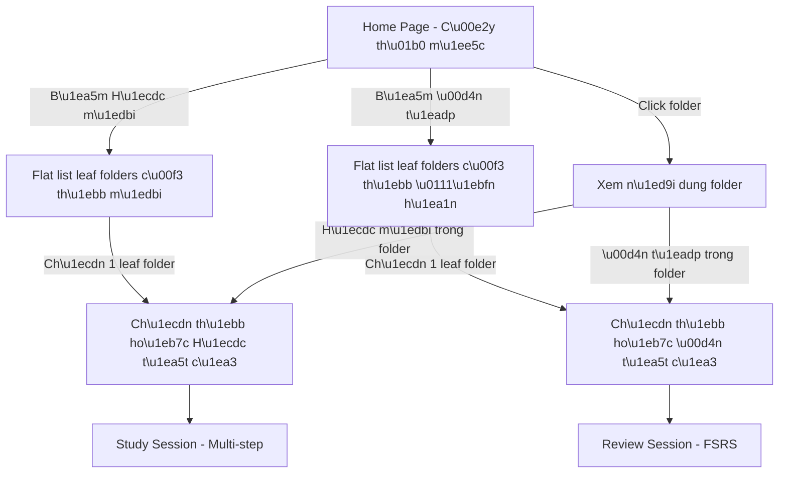
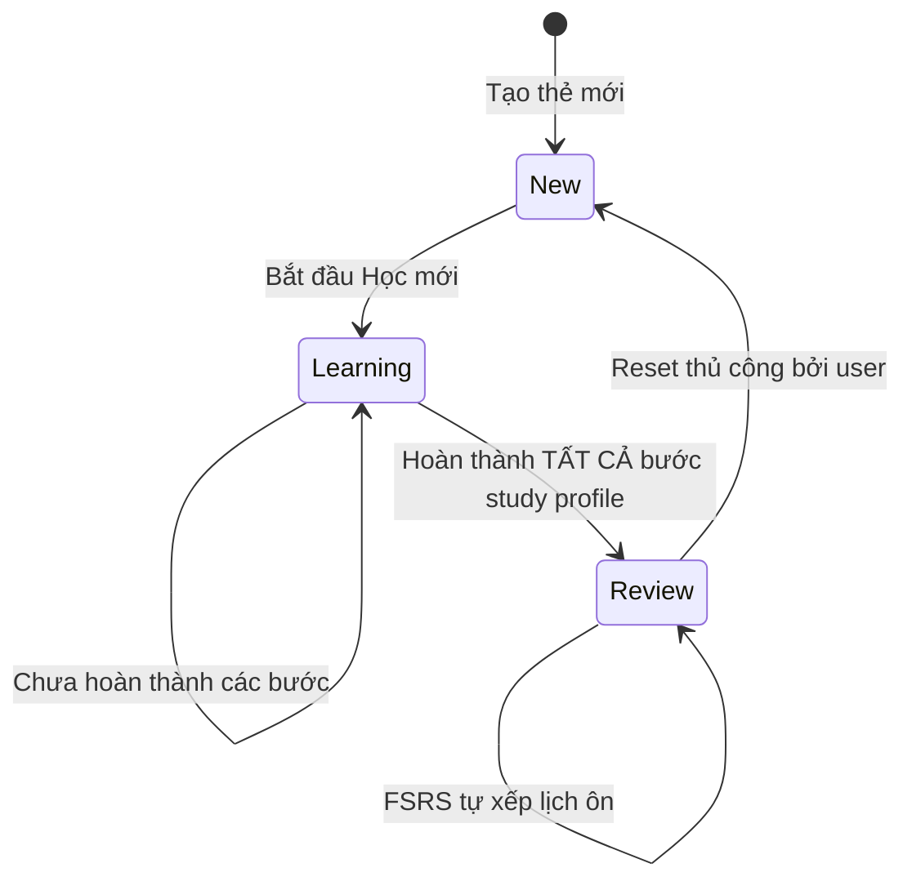
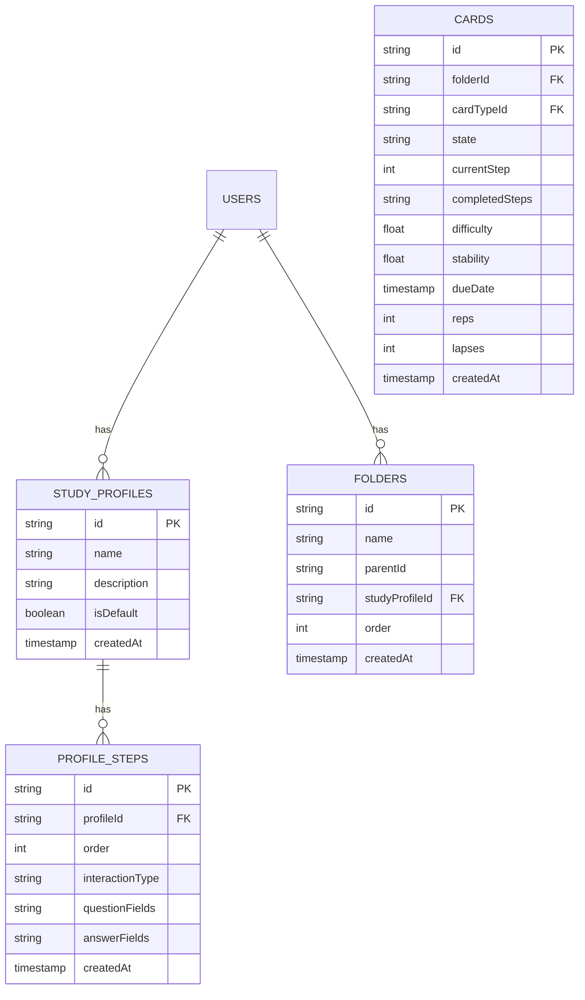
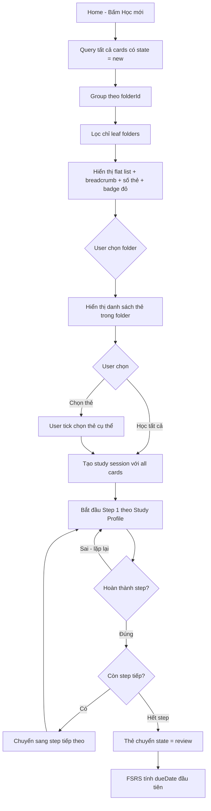
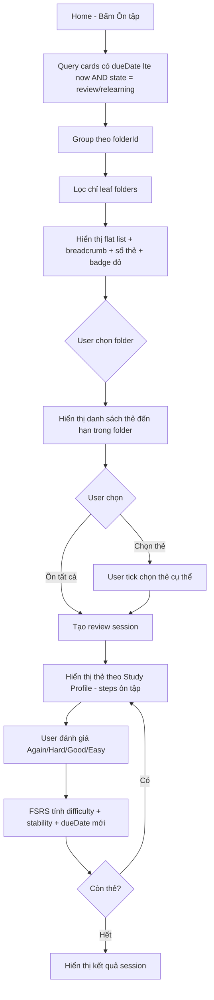

# 📘 Phase 4: Thiết kế Học mới & Ôn tập - Chi tiết

## 1. Tổng quan kiến trúc mới

### 1.1 Thay đổi Home Page
- Home Page = **Cây thư mục** là trung tâm
- 2 nút **Học mới** / **Ôn tập** nằm ở trên cùng
- Bấm "Học mới" → hiển thị flat list các **leaf folders** có thẻ mới cần học (kèm ❗ đỏ)
- Bấm "Ôn tập" → hiển thị flat list các **leaf folders** có thẻ đến hạn ôn (kèm ❗ đỏ)
- Giữ phần thống kê tổng quan

### 1.2 Mermaid: Luồng UX tổng thể



---

## 2. Trạng thái thẻ - Card State Machine



### Trạng thái chi tiết:
- **new**: Thẻ mới tạo, chưa học lần nào
- **learning**: Đang trong quá trình Học mới - theo dõi bước nào đã hoàn thành
- **review**: Đã hoàn thành Học mới, FSRS quản lý lịch ôn tập
- **relearning**: Quên khi ôn tập, FSRS đưa vào học lại ngắn hạn

---

## 3. Study Profile - Hồ sơ học tập

### 3.1 Cấu trúc Study Profile

Mỗi profile chứa nhiều **steps** - bước. Mỗi bước định nghĩa:
- **Kiểu tương tác** - interaction type
- **Field câu hỏi** - question field: hiển thị cho user
- **Field đáp án** - answer field: đáp án cần recall/nhập
- **Thứ tự bước** - step order

### 3.2 Các kiểu tương tác - Interaction Types

| ID | Tên | Mô tả |
|---|---|---|
| `flashcard` | Flashcard lật | Hiển thị mặt trước → lật xem mặt sau → tự đánh giá |
| `cloze_type` | Cloze điền từ | Đục lỗ trong câu → gõ từ vào chỗ trống |
| `cloze_listen` | Nghe điền từ | Phát audio → gõ từ nghe được vào chỗ trống |
| `reverse_type` | Gõ ngược | Hiển thị nghĩa tiếng Việt → gõ lại từ gốc |

### 3.3 Ví dụ Study Profile

```
Profile: "IELTS Vocabulary Full"
├── Step 1: flashcard     | Q: word + IPA     | A: meaning + example
├── Step 2: cloze_type    | Q: example câu    | A: word
├── Step 3: cloze_listen  | Q: audio           | A: word
└── Step 4: reverse_type  | Q: meaning VN      | A: word EN

Áp dụng cho:
├── Chế độ Học mới: Phải hoàn thành Step 1→2→3→4
└── Chế độ Ôn tập: Chỉ dùng Step 2→3→4 (bỏ flashcard xem)
```

### 3.4 Profile áp dụng cho thư mục
- Mỗi leaf folder có thể gán 1 Study Profile
- Profile mặc định: Flashcard lật đơn giản
- User tạo/lưu nhiều profile, áp dụng tùy ý cho các folder khác nhau

---

## 4. Data Model mới/cập nhật

### 4.1 Collections cần thêm/sửa



### 4.2 Thay đổi trên Card model

Thêm fields mới cho tracking multi-step:

| Field | Type | Mô tả |
|---|---|---|
| `currentStep` | int | Bước hiện tại trong Study Profile: 0, 1, 2, 3... |
| `completedSteps` | array/string | Danh sách các step đã hoàn thành: vd [0,1] |
| `state` | string | Cập nhật: new / learning / review / relearning |

### 4.3 Thay đổi trên Folder model

| Field | Type | Mô tả |
|---|---|---|
| `studyProfileId` | string/null | ID của Study Profile áp dụng cho folder này |

---

## 5. Luồng chi tiết - Học mới

### 5.1 Từ Home đến Study Session



### 5.2 Từ Home đến Review Session



---

## 6. UI Wireframes - Mô tả

### 6.1 Home Page mới
```
┌─────────────────────────────────────┐
│ 🦉 LinguaFlash              👤     │  ← Header
├─────────────────────────────────────┤
│                                     │
│  📊 Thống kê tổng quan             │
│  ┌──────┐ ┌──────┐ ┌──────┐ ┌────┐ │
│  │ 120  │ │  15  │ │  25  │ │ 7  │ │
│  │Tổng  │ │Hôm   │ │Cần   │ │Day │ │
│  │thẻ   │ │nay   │ │ôn    │ │Stre│ │
│  └──────┘ └──────┘ └──────┘ └────┘ │
│                                     │
│  ┌─────────────┐ ┌─────────────┐   │
│  │ 📖 Học mới  │ │ 🔄 Ôn tập  │   │
│  │   (8 thẻ)   │ │  (25 thẻ)  │   │
│  └─────────────┘ └─────────────┘   │
│                                     │
│  📁 Thư mục của tôi                │
│  ├── 📁 Tiếng Anh                  │
│  │   ├── 📁 IELTS                  │
│  │   │   ├── 📁 Writing            │
│  │   │   └── 📁 Speaking           │
│  │   └── 📁 Giao tiếp             │
│  └── 📁 Tiếng Nhật                │
│      └── 📁 N5                     │
│                                     │
│  ➕ Tạo thư mục mới               │
└─────────────────────────────────────┘
```

### 6.2 Màn hình "Học mới" - Flat list
```
┌─────────────────────────────────────┐
│ ← Quay lại    📖 Học mới           │
├─────────────────────────────────────┤
│                                     │
│  Tổng: 8 thẻ mới cần học           │
│                                     │
│  ┌─────────────────────────────┐   │
│  │ 🔴 Task 1         5 thẻ    │   │
│  │ 📍 Tiếng Anh > IELTS > Wri │   │
│  └─────────────────────────────┘   │
│  ┌─────────────────────────────┐   │
│  │ 🔴 Part 2         2 thẻ    │   │
│  │ 📍 Tiếng Anh > IELTS > Spe │   │
│  └─────────────────────────────┘   │
│  ┌─────────────────────────────┐   │
│  │ 🔴 Nhà hàng       1 thẻ    │   │
│  │ 📍 Tiếng Anh > Giao tiếp   │   │
│  └─────────────────────────────┘   │
│                                     │
└─────────────────────────────────────┘
```

### 6.3 Màn hình chọn thẻ trong folder
```
┌─────────────────────────────────────┐
│ ← Quay lại    📁 Task 1            │
├─────────────────────────────────────┤
│                                     │
│  📍 Tiếng Anh > IELTS > Writing    │
│  5 thẻ mới | Profile: IELTS Vocab  │
│                                     │
│  ┌────────────────────────────────┐ │
│  │ ☑ Học tất cả (5 thẻ)          │ │
│  └────────────────────────────────┘ │
│                                     │
│  ☑ environment - môi trường        │
│  ☑ sustainable - bền vững          │
│  ☑ pollution - ô nhiễm             │
│  ☑ renewable - tái tạo             │
│  ☑ ecosystem - hệ sinh thái       │
│                                     │
│  ┌────────────────────────────────┐ │
│  │     ▶ Bắt đầu học (5 thẻ)     │ │
│  └────────────────────────────────┘ │
└─────────────────────────────────────┘
```

---

## 7. Cấu trúc file mới cần tạo

```
public/src/js/
├── pages/
│   ├── home.js          ← Sửa lại: thêm folder tree + nút Học/Ôn
│   ├── study.js         ← Sửa lại: implement Study Session
│   ├── review.js        ← Sửa lại: implement Review Session  
│   ├── folder-view.js   ← MỚI: xem nội dung folder
│   └── study-profile.js ← MỚI: quản lý Study Profiles
├── db/
│   └── firestore.js     ← Sửa: thêm CRUD cho study_profiles, profile_steps
└── ui/
    └── folder-tree.js   ← MỚI: component cây thư mục
```

---

## 8. Thứ tự triển khai đề xuất

### Giai đoạn 4A: Nền tảng thư mục
1. Cập nhật Firestore data model - thêm studyProfileId cho folders
2. Tạo component cây thư mục - folder-tree.js
3. Redesign Home Page - đặt cây thư mục làm trung tâm
4. Tạo folder-view.js - xem nội dung folder
5. CRUD thư mục: tạo, sửa, xóa, di chuyển

### Giai đoạn 4B: Study Profile
6. Tạo data model Study Profile + Profile Steps
7. CRUD Study Profile trong Firestore
8. UI quản lý Study Profile (tạo/sửa/xóa profile)
9. Gán Study Profile cho folder
10. Tạo profile mặc định: Flashcard đơn giản

### Giai đoạn 4C: Card Management
11. Cập nhật Card model - thêm currentStep, completedSteps
12. CRUD Card Types + Fields
13. UI tạo/sửa/xóa flashcard với nhiều fields
14. Hiển thị cards trong folder view

### Giai đoạn 4D: Chế độ Học mới
15. Logic flat list leaf folders có thẻ mới
16. Màn hình chọn folder → chọn thẻ
17. Study Session engine - multi-step theo profile
18. Implement interaction: Flashcard lật
19. Implement interaction: Cloze điền từ
20. Implement interaction: Nghe điền từ
21. Implement interaction: Gõ ngược
22. Logic chuyển state: learning → review khi hoàn thành
23. Logic reset: review → new thủ công

### Giai đoạn 4E: Chế độ Ôn tập
24. Logic flat list leaf folders có thẻ đến hạn
25. Màn hình chọn folder → chọn thẻ ôn
26. Review Session engine - FSRS integration
27. Đánh giá Again/Hard/Good/Easy
28. FSRS tính toán dueDate mới
29. Badge thông báo số thẻ cần ôn trên Home

### Giai đoạn 4F: Polish
30. Thống kê trên Home page - kết nối data thực
31. Animation và transitions cho study/review sessions
32. Deploy và test trên production
