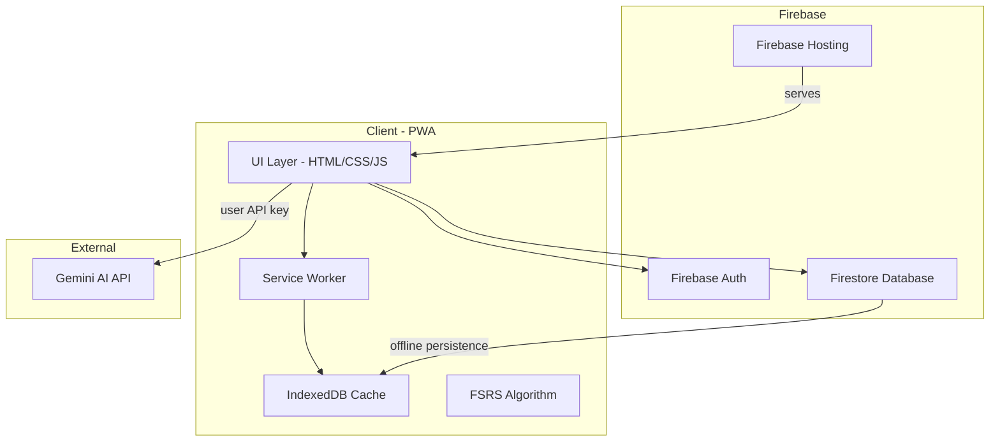
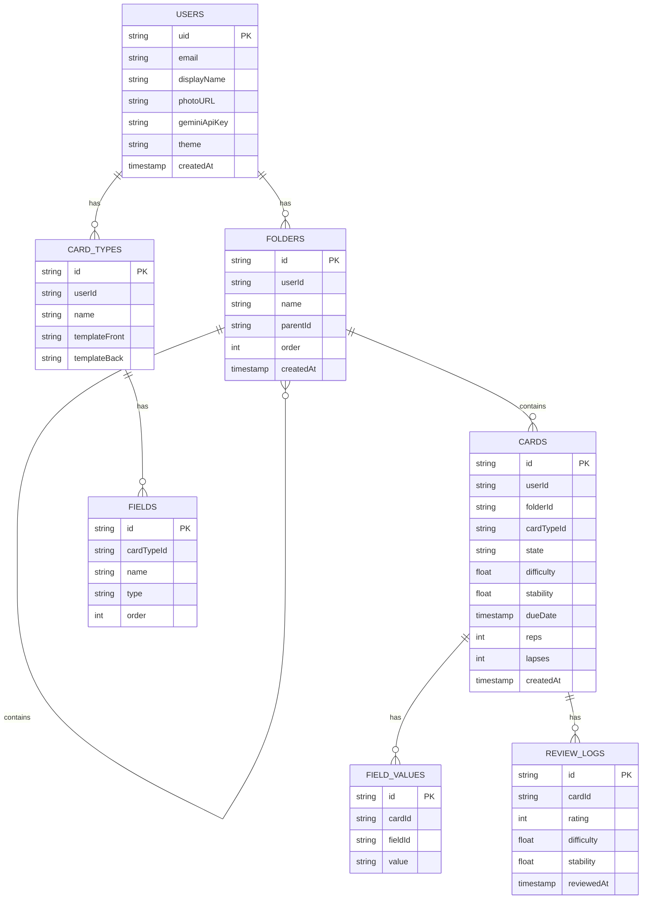
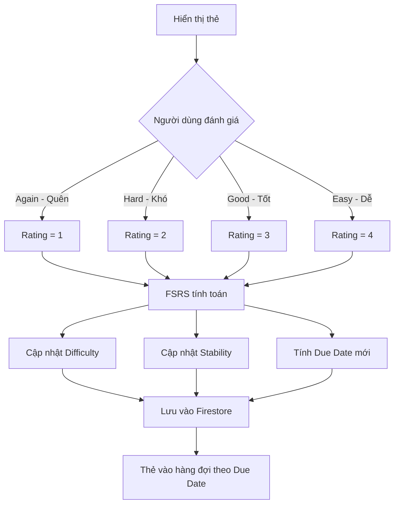
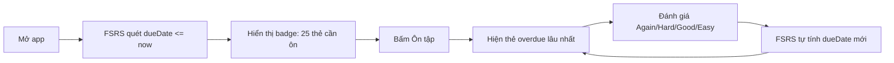
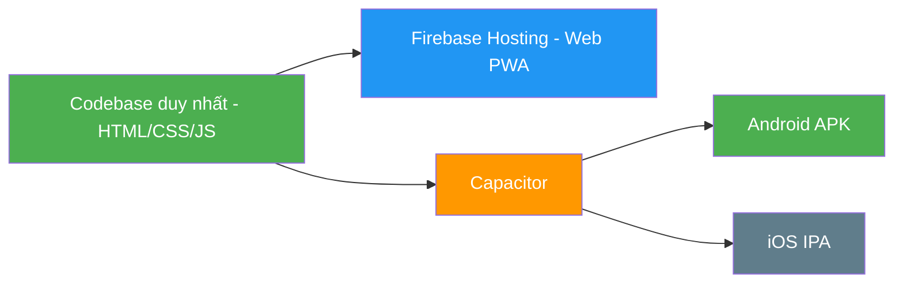

# 📘 KẾ HOẠCH TRIỂN KHAI: ỨNG DỤNG HỌC NGOẠI NGỮ

## 1. Tổng quan dự án

**Mục tiêu**: Xây dựng PWA học từ vựng ngoại ngữ đa ngôn ngữ, tập trung vào học mới và ôn tập, hỗ trợ cả online lẫn offline.

**Stack công nghệ**:
- Frontend: Vanilla HTML/CSS/JS (PWA)
- Backend: Firebase Spark Plan (Firestore, Auth, Hosting)
- AI: Gemini API (người dùng tự nhập API key)
- Thuật toán ôn tập: FSRS (Free Spaced Repetition Scheduler)

**Đối tượng**: Người học ngoại ngữ, đặc biệt là ôn thi IELTS

---

## 2. Kiến trúc hệ thống



---

## 3. Cấu trúc thư mục dự án

```
linguaflash/
├── public/
│   ├── index.html              # Entry point
│   ├── manifest.json           # PWA manifest
│   ├── sw.js                   # Service Worker
│   ├── icons/                  # PWA icons các kích thước
│   │   └── icon-192.png
│   └── src/
│       ├── css/
│       │   ├── variables.css       # CSS variables cho theme
│       │   ├── base.css            # Reset, typography
│       │   ├── themes.css          # Dark/Light mode styles
│       │   ├── components.css      # UI components
│       │   ├── glassmorphism.css   # Hiệu ứng kiểu Apple
│       │   ├── animations.css      # Hiệu ứng, transitions
│       │   └── responsive.css      # Media queries
│       └── js/
│           ├── app.js              # Main app initialization
│           ├── router.js           # SPA routing
│           ├── firebase-config.js  # Firebase initialization
│           ├── auth/
│           │   ├── auth.js         # Auth logic
│           │   └── auth-ui.js      # Auth UI components
│           ├── db/
│           │   ├── firestore.js    # Firestore operations
│           │   └── sync.js         # Online/Offline sync
│           ├── fsrs/
│           │   └── fsrs.js         # FSRS algorithm implementation
│           ├── pages/
│           │   ├── home.js         # Trang chính - thư mục cây
│           │   ├── study.js        # Trang học mới
│           │   ├── review.js       # Trang ôn tập
│           │   ├── settings.js     # Trang cài đặt
│           │   ├── account.js      # Trang tài khoản
│           │   └── auth-page.js    # Trang đăng nhập/đăng ký
│           ├── ui/
│           │   ├── theme.js        # Theme switching logic
│           │   ├── background.js   # Floating icons animation
│           │   ├── components.js   # Reusable UI components
│           │   └── toast.js        # Notification system
│           └── utils/
│               └── helpers.js      # Utility functions
├── plans/
│   └── plan.md                 # Kế hoạch triển khai
├── firebase.json               # Firebase config
├── firestore.rules             # Firestore security rules
├── .firebaserc                 # Firebase project config
├── vercel.json                 # Vercel deployment config
└── .gitignore
```

---

## 4. Data Model - Firestore

### 4.1 Collections Structure



### 4.2 Chi tiết fields

**Card states** (trạng thái thẻ):
- `new` - Thẻ mới chưa học
- `learning` - Đang học lần đầu
- `review` - Đang trong chu kỳ ôn tập
- `relearning` - Quên, cần học lại

**FSRS parameters trên mỗi Card**:
- `difficulty` (0-1): Độ khó của thẻ
- `stability` (ngày): Thời gian ổn định trong trí nhớ
- `dueDate`: Ngày cần ôn tập tiếp
- `reps`: Số lần đã ôn
- `lapses`: Số lần quên

---

## 5. FSRS Algorithm

FSRS (Free Spaced Repetition Scheduler) là thuật toán hiện đại thay thế SM-2, được dùng trong Anki v23+.

### Nguyên lý hoạt động:



### Implementation:
- Sử dụng thư viện **ts-fsrs** (có bản JS) hoặc tự implement công thức FSRS v5
- 4 mức đánh giá: Again / Hard / Good / Easy
- Tự động tính khoảng cách ôn tập tối ưu

### ⚡ Chế độ ôn tập TỰ ĐỘNG:
- Hệ thống **tự động quét tất cả thẻ** và đưa thẻ đến hạn (`dueDate <= now`) vào hàng đợi ôn tập
- Khi mở app, hiển thị **badge số thẻ cần ôn** ngay trên màn hình chính
- Người dùng bấm "Ôn tập" → thẻ cần ôn hiện ra tự động theo thứ tự ưu tiên (overdue lâu nhất trước)
- Sau mỗi lần đánh giá, FSRS **tự động tính `dueDate` mới** → không cần cấu hình thủ công
- Thẻ mới cũng được tự động xếp lịch: học xong → FSRS tính ngay lần ôn đầu tiên
- **Thông báo nhắc nhở** (nếu có permission) khi có thẻ đến hạn ôn



### 🔤 Case-Insensitive - Không phân biệt hoa/thường:
- Tất cả chức năng so khớp từ vựng (Cloze, quiz, tìm kiếm) đều **không phân biệt chữ hoa/thường**
- VD: Nhập "environment", "Environment", "ENVIRONMENT" → đều được tính đúng
- Áp dụng `toLowerCase()` khi so sánh đáp án
- Có thể mở rộng: bỏ qua dấu cách thừa, dấu chấm câu cuối

---

## 6. Kế hoạch triển khai theo Phase

### Phase 1: Foundation + Deploy - Nền tảng & Triển khai lên server
1. Khởi tạo project structure và các file cơ bản
2. Setup Firebase project (Firestore, Auth, Hosting)
3. Xây dựng PWA foundation (manifest.json, service worker, offline cache)
4. Implement SPA router
5. **Deploy lên Firebase Hosting** (có trang trống chạy được trên web)
6. Kiểm tra PWA hoạt động trên mobile browser

### Phase 2: UI Framework + Theme - Giao diện hoàn chỉnh
7. Xây dựng hệ thống theme (Dark/Light/System mode, CSS variables)
8. Phối màu gradient riêng cho từng mode
9. Hiệu ứng glassmorphism (gương mờ đục, blur kiểu Apple)
10. Hiệu ứng nổi khối, animation khi tương tác nút
11. Background floating icons (kiểu Kahoot)
12. Responsive design (mobile/tablet/desktop)

### Phase 3: Authentication - Xác thực (hoàn thiện 100%)
13. Trang đăng ký (email + Google sign-in)
14. Xác thực email khi đăng ký
15. Trang đăng nhập
16. Avatar và user menu góc phải
17. Chức năng đổi mật khẩu
18. Chức năng xóa tài khoản (xác nhận qua email)
19. Trang Settings cơ bản (đổi theme, quản lý tài khoản)
20. **Deploy & test Auth** trên production

### Phase 4: Core Features - Tính năng lõi
21. Quản lý thư mục dạng cây (tạo, sửa, xóa, kéo thả, lồng nhau)
22. Quản lý Card Types và Fields (tạo template thẻ)
23. Tạo/sửa/xóa Flashcard với nhiều fields
24. Implement FSRS algorithm (ôn tập tự động)
25. Chế độ học mới (Study session)
26. Chế độ ôn tập tự động (Review session + badge thông báo)
27. Cloze deletion (đục lỗ điền từ, case-insensitive)
28. **Deploy & test Core Features** trên production

### Phase 5: AI & Advanced - Nâng cao
29. Mục nhập API key trong Settings
30. Tích hợp Gemini AI (gọi API từ client)
31. AI tự động điền fields cho thẻ
32. AI giải thích từ vựng, tạo câu ví dụ
33. Export/Import bộ từ vựng (JSON format)
34. Tạo bộ từ mẫu IELTS

### Phase 6: Polish & Cross-platform - Hoàn thiện & Đa nền tảng
35. Thống kê học tập (số từ đã học, streak, tiến độ)
36. Performance optimization & caching
37. Testing toàn bộ chức năng
38. Viết hướng dẫn sử dụng (README)
39. **Tích hợp Capacitor** - wrap PWA thành native app
40. Build APK Android
41. (Tùy chọn) Build IPA iOS nếu có Mac

---

## 7. Chiến lược đa nền tảng: PWA + Capacitor

### Giai đoạn 1: PWA Web (làm trước)
- Hoàn thiện toàn bộ tính năng trên web
- Deploy Firebase Hosting
- PWA có thể cài từ trình duyệt trên điện thoại

### Giai đoạn 2: Capacitor wrap (làm sau khi web xong)
- Thêm Capacitor vào project
- Giữ nguyên 90-95% code web
- Build ra APK cho Android (miễn phí, publish Google Play)
- Build ra IPA cho iOS (cần Mac + Apple Developer $99/năm)



### Lưu ý Capacitor:
- Không cần học ngôn ngữ mới
- Hỗ trợ native APIs: Push Notifications, Camera, File System
- Hot reload trong quá trình phát triển
- Cộng đồng lớn, maintained bởi Ionic team

---

## 8. Rủi ro và giải pháp

| Rủi ro | Giải pháp |
|---|---|
| Firebase Spark Plan hết quota | Monitor usage, tối ưu reads/writes |
| FSRS phức tạp | Dùng thư viện có sẵn, fallback SM-2 nếu cần |
| Offline sync conflict | Firestore tự handle, thiết kế data model tốt |
| Gemini API tốn tiền | User tự nhập key, đặt rate limit phía client |
| PWA trên iOS hạn chế | Capacitor giải quyết, native app đầy đủ quyền |
| Capacitor build lỗi | Test kỹ web trước, Capacitor chỉ wrap sau cùng |
