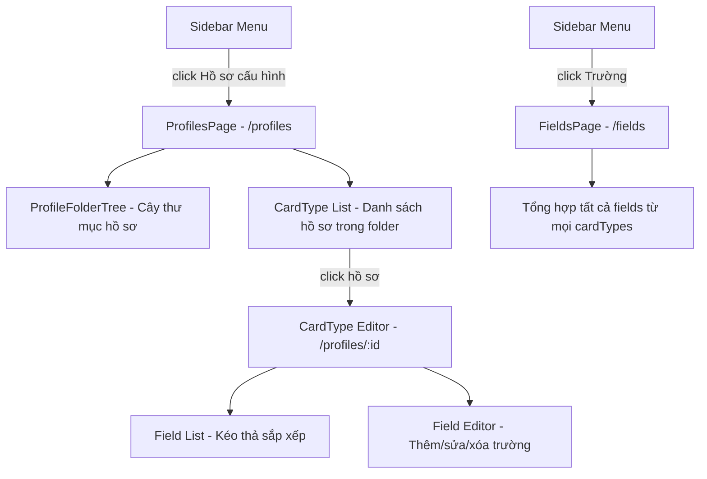

# Thiết kế: Hồ sơ cấu hình thẻ học tập + Trường

## 1. Tổng quan

Trang **Hồ sơ cấu hình** cho phép user tạo và quản lý các loại thẻ (Card Types / Note Types) - tương tự Anki. Mỗi hồ sơ cấu hình định nghĩa:
- Tên hồ sơ (VD: "Từ vựng cơ bản", "Ngữ pháp N3", "Kanji")
- Danh sách **Trường** (Fields) - các trường dữ liệu mà thẻ thuộc hồ sơ này sẽ có
- Template hiển thị mặt trước/sau (giai đoạn sau)

Hệ thống thư mục lồng nhau riêng biệt để phân nhóm hồ sơ (KHÔNG hiện ở lobby chính).

## 2. Firestore Schema

```
users/{userId}/
├── folders/{folderId}           ← Thư mục thẻ (đã có, lobby chính)
│   ├── name: string
│   ├── parentId: string | null
│   ├── order: number
│   ├── coverImage: string | null
│   └── createdAt: timestamp
│
├── profileFolders/{folderId}    ← THƯ MỤC HỒ SƠ (MỚI, riêng biệt)
│   ├── name: string
│   ├── parentId: string | null
│   ├── order: number
│   ├── coverImage: string | null
│   └── createdAt: timestamp
│
├── cardTypes/{typeId}           ← HỒ SƠ CẤU HÌNH (MỚI)
│   ├── name: string             (VD: "Từ vựng N5")
│   ├── folderId: string | null  (→ profileFolders, để phân nhóm)
│   ├── fields: [                (danh sách trường, lưu inline)
│   │   { name: "Từ", type: "text", required: true, order: 0 },
│   │   { name: "Nghĩa", type: "text", required: true, order: 1 },
│   │   { name: "Phiên âm", type: "text", required: false, order: 2 },
│   │   { name: "Ví dụ", type: "textarea", required: false, order: 3 }
│   │ ]
│   ├── frontTemplate: string    (HTML template mặt trước - giai đoạn sau)
│   ├── backTemplate: string     (HTML template mặt sau - giai đoạn sau)
│   ├── order: number
│   └── createdAt: timestamp
│
├── cards/{cardId}               ← Thẻ học tập (đã có)
│   ├── folderId: string         (→ folders, thư mục thẻ)
│   ├── cardTypeId: string       (→ cardTypes, hồ sơ cấu hình)
│   ├── fieldValues: {           (giá trị các trường)
│   │   "Từ": "apple",
│   │   "Nghĩa": "quả táo",
│   │   "Phiên âm": "/ˈæp.əl/"
│   │ }
│   ├── state, difficulty, stability, dueDate, reps, lapses (FSRS)
│   └── createdAt: timestamp
```

### Quyết định thiết kế:
- **Fields lưu inline** trong cardTypes document (array of objects) thay vì subcollection riêng → Đơn giản hơn, ít query hơn, phù hợp với số lượng fields ít (~5-15 field/type)
- **profileFolders** tách biệt hoàn toàn khỏi `folders` → Không xuất hiện ở lobby
- **Field types**: `text`, `textarea`, `richtext` (giai đoạn sau), `image` (giai đoạn sau)

## 3. Kiến trúc Component



## 4. Routes

| Route | Page | Mô tả |
|-------|------|-------|
| `/profiles` | ProfilesPage | Trang chính - cây thư mục + danh sách hồ sơ |
| `/profiles/:id` | ProfileEditorPage | Xem/sửa chi tiết 1 hồ sơ cấu hình |
| `/fields` | FieldsPage | Tổng hợp trường từ tất cả hồ sơ |

## 5. Các file cần tạo/sửa

### Files MỚI:
| File | Mô tả |
|------|-------|
| `public/src/js/pages/profiles.js` | Trang chính Hồ sơ cấu hình (SỬA file placeholder hiện có) |
| `public/src/js/pages/profile-editor.js` | Trang chi tiết/sửa 1 hồ sơ |
| `public/src/js/ui/profile-folder-tree.js` | Component cây thư mục hồ sơ (tái sử dụng pattern từ folder-tree.js) |

### Files SỬA:
| File | Thay đổi |
|------|----------|
| `public/src/js/db/firestore.js` | Thêm CRUD cho profileFolders + cardTypes |
| `public/src/js/pages/fields.js` | Sửa từ placeholder → trang tổng hợp fields |
| `public/src/js/app.js` | Đăng ký route `/profiles/:id` |
| `public/index.html` | Thêm script tags mới |
| `public/sw.js` | Thêm assets mới |
| `firestore.rules` | Thêm rules cho profileFolders |

## 6. UI/UX Design

### 6.1 Trang Hồ sơ cấu hình (/profiles)

```
┌─────────────────────────────────────────────┐
│ ◄ Hồ sơ cấu hình                    [+ Mới]│
├──────────────┬──────────────────────────────┤
│              │                              │
│  📁 Ngôn ngữ│  ┌──────┐ ┌──────┐ ┌──────┐ │
│  ├─📁 JP    │  │ Từ   │ │ Ngữ  │ │ Kanji│ │
│  ├─📁 EN    │  │ vựng │ │ pháp │ │      │ │
│  └─📁 KR    │  │ N5   │ │ N3   │ │ N4   │ │
│              │  │ 5 trg│ │ 3 trg│ │ 4 trg│ │
│  📁 Chung   │  └──────┘ └──────┘ └──────┘ │
│              │                              │
│              │  [+ Tạo hồ sơ mới]          │
├──────────────┴──────────────────────────────┤
│ Trên mobile: folder tree ẩn, hiện khi bấm  │
└─────────────────────────────────────────────┘
```

### 6.2 Trang chi tiết hồ sơ (/profiles/:id)

```
┌─────────────────────────────────────────────┐
│ ◄ Từ vựng N5                    [Lưu] [Xóa]│
├─────────────────────────────────────────────┤
│ Tên: [Từ vựng N5                          ] │
│ Thư mục: [Ngôn ngữ > JP            ▼     ] │
├─────────────────────────────────────────────┤
│ DANH SÁCH TRƯỜNG                   [+ Thêm]│
│                                              │
│ ≡ 1. Từ          [text]    [Bắt buộc] [✏️🗑]│
│ ≡ 2. Nghĩa       [text]    [Bắt buộc] [✏️🗑]│
│ ≡ 3. Phiên âm    [text]    [        ] [✏️🗑]│
│ ≡ 4. Ví dụ       [textarea][        ] [✏️🗑]│
│                                              │
│ (Kéo ≡ để sắp xếp)                          │
└─────────────────────────────────────────────┘
```

### 6.3 Trang Trường (/fields)

```
┌─────────────────────────────────────────────┐
│ ◄ Trường                                    │
├─────────────────────────────────────────────┤
│ Tổng hợp tất cả trường từ mọi hồ sơ        │
│                                              │
│ ┌─ Từ vựng N5 ─────────────────────────┐    │
│ │ • Từ (text, bắt buộc)                │    │
│ │ • Nghĩa (text, bắt buộc)             │    │
│ │ • Phiên âm (text)                     │    │
│ │ • Ví dụ (textarea)                    │    │
│ └───────────────────────────────────────┘    │
│                                              │
│ ┌─ Ngữ pháp N3 ────────────────────────┐    │
│ │ • Mẫu câu (text, bắt buộc)           │    │
│ │ • Giải thích (textarea, bắt buộc)     │    │
│ │ • Ví dụ (textarea)                    │    │
│ └───────────────────────────────────────┘    │
└─────────────────────────────────────────────┘
```

## 7. Implementation Plan (theo thứ tự)

### Phase 1: Firestore + ProfileFolders
1. Thêm Firestore rules cho `profileFolders`
2. Thêm CRUD methods vào `firestore.js`: `getProfileFolders()`, `createProfileFolder()`, `updateProfileFolder()`, `deleteProfileFolder()`
3. Thêm CRUD methods cho `cardTypes`: `getCardTypes()`, `createCardType()`, `updateCardType()`, `deleteCardType()`

### Phase 2: Profile Folder Tree Component
4. Tạo `profile-folder-tree.js` - refactor từ `folder-tree.js`, thay collection `folders` → `profileFolders`
5. Hỗ trợ: tạo, đổi tên, xóa, lồng thư mục

### Phase 3: Profiles Page
6. Sửa `profiles.js` - layout 2 cột: folder tree bên trái, danh sách cardTypes bên phải
7. Card type cards: hiển thị tên, số fields, nút sửa/xóa
8. Nút tạo hồ sơ mới (modal)

### Phase 4: Profile Editor Page
9. Tạo `profile-editor.js` - form sửa tên, chọn thư mục
10. Danh sách fields: thêm, sửa, xóa, sắp xếp (drag & drop đơn giản hoặc nút lên/xuống)
11. Field editor: tên, type (text/textarea), bắt buộc hay không

### Phase 5: Fields Page
12. Sửa `fields.js` - hiển thị tổng hợp tất cả fields theo nhóm cardType

### Phase 6: Wiring
13. Đăng ký route `/profiles/:id` trong `app.js`
14. Thêm script tags vào `index.html`
15. Thêm assets vào `sw.js`
16. Bump versions + commit & push
