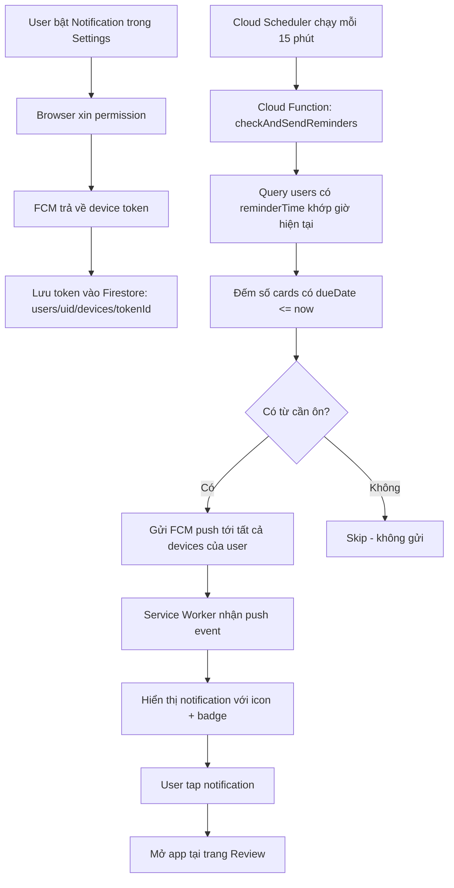

# Push Notification - Nhắc ôn từ vựng hàng ngày

## Tổng quan

Gửi push notification nhắc user ôn từ vựng mỗi ngày theo giờ user chọn.
Nội dung: "Bạn có X từ cần ôn hôm nay 📚"

## Kiến trúc



## Platform Support

| Platform | Browser | Yêu cầu |
|----------|---------|----------|
| Android | Chrome, Edge | Notification permission |
| Windows | Chrome, Edge | Notification permission |
| macOS | Chrome, Edge, Safari 16.4+ | Notification permission |
| iOS | Safari 16.4+ | App phải được Add to Home Screen + permission |

## Cấu trúc Firestore

```
users/{uid}/
  ├── settings.reminderEnabled: boolean
  ├── settings.reminderTime: "08:00"  (HH:mm, timezone user)
  ├── settings.timezone: "Asia/Saigon"
  └── devices/{tokenHash}/
        ├── token: "fcm-token-string..."
        ├── platform: "android" | "windows" | "macos" | "ios"
        ├── browser: "chrome" | "edge" | "safari"
        ├── createdAt: timestamp
        └── lastActive: timestamp
```

## Files cần tạo/sửa

### Frontend (public/)

1. **public/src/js/notifications/push-manager.js** (MỚI)
   - Request notification permission
   - Get FCM token
   - Save/refresh token to Firestore
   - Handle token refresh

2. **public/src/js/pages/settings.js** (SỬA)
   - Thêm section "Thông báo nhắc ôn"
   - Toggle bật/tắt notification
   - Time picker chọn giờ nhắc
   - Hiển thị trạng thái permission

3. **public/sw.js** (SỬA)
   - Thêm `push` event listener
   - Thêm `notificationclick` event listener
   - Hiển thị notification với title, body, icon, badge

4. **public/firebase-messaging-sw.js** (MỚI)
   - Firebase Messaging SW file (required by FCM)
   - Import firebase-messaging-compat
   - Handle background messages

5. **public/index.html** (SỬA)
   - Thêm firebase-messaging-compat SDK script
   - Thêm push-manager.js script

### Backend (functions/)

6. **functions/index.js** (SỬA)
   - Thêm Cloud Function `sendReviewReminders`
   - Scheduled function chạy mỗi 15 phút
   - Query users có reminder khớp giờ hiện tại
   - Đếm cards due, gửi FCM

### Config

7. **firebase.json** (SỬA - nếu cần)
   - Đảm bảo firebase-messaging-sw.js được serve đúng

## Chi tiết Implementation

### 1. Frontend - Push Manager

```javascript
// public/src/js/notifications/push-manager.js
const PushManager = {
    async init() { ... },
    async requestPermission() { ... },
    async getToken() { ... },
    async saveTokenToFirestore(token) { ... },
    async removeToken() { ... },
    isSupported() { ... }
};
```

### 2. Service Worker - Push Handler

```javascript
// Trong sw.js hoặc firebase-messaging-sw.js
self.addEventListener('push', (event) => {
    const data = event.data.json();
    self.registration.showNotification(data.title, {
        body: data.body,
        icon: '/icons/icon-192.png',
        badge: '/icons/icon-96.png',
        data: { url: '/#/review' }
    });
});

self.addEventListener('notificationclick', (event) => {
    event.notification.close();
    event.waitUntil(clients.openWindow(event.notification.data.url));
});
```

### 3. Cloud Function - Scheduled Reminder

```javascript
// functions/index.js
exports.sendReviewReminders = onSchedule('every 15 minutes', async (event) => {
    // 1. Tính giờ hiện tại theo từng timezone
    // 2. Query users có reminderTime khớp (±7 phút buffer)
    // 3. Với mỗi user: đếm cards có dueDate <= now
    // 4. Nếu có cards due: gửi FCM tới tất cả devices
});
```

### 4. Settings UI

- Toggle switch: Bật/tắt thông báo
- Time picker: Chọn giờ nhắc (mặc định 8:00)
- Status text: Hiển thị trạng thái (đã bật, bị chặn, chưa hỗ trợ)

## Lưu ý quan trọng

1. **VAPID Key**: Cần generate VAPID key pair trong Firebase Console > Cloud Messaging
2. **iOS Safari**: User PHẢI add app to Home Screen trước khi push hoạt động
3. **Token refresh**: FCM token có thể thay đổi, cần handle `onTokenRefresh`
4. **Quota**: Firebase free tier cho 500 devices/day (đủ cho app nhỏ)
5. **Timezone**: Lưu timezone của user để gửi đúng giờ local
6. **Dedup**: Không gửi lại nếu đã gửi trong ngày (dùng lastNotifiedDate)
