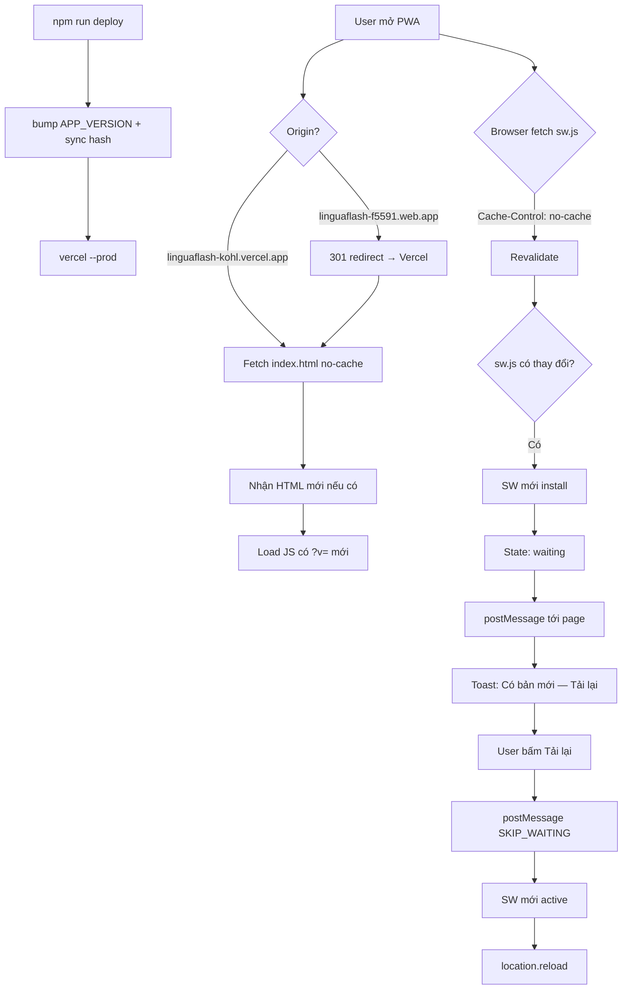
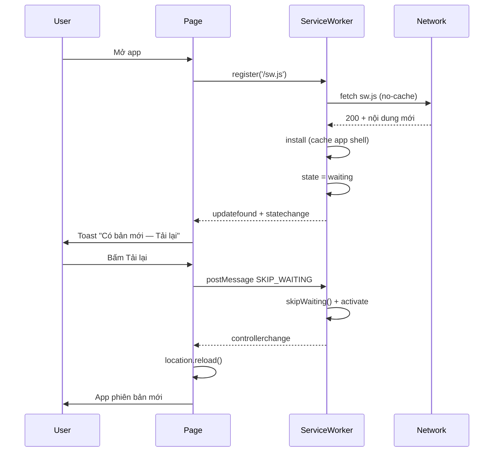

# 🔄 Quy hoạch cập nhật PWA tự động cho người dùng cuối

> **Trạng thái triển khai (2026-05-19):** ✅ Toàn bộ 5 phase đã hoàn tất.
>
> **Production host (canonical):** Vercel — https://linguaflash-kohl.vercel.app
>
> **Firebase Hosting** đã chuyển sang **redirect-only** (301 → Vercel) trong [`firebase.json`](../firebase.json:1) để consolidate user về 1 origin duy nhất, tránh fragmenting PWA install.
>
> Workflow deploy: `npm run deploy` (tự bump version + sync hash + `vercel --prod`).

## 1. Bối cảnh & vấn đề

Mỗi khi deploy bản mới, dev phải vào DevTools → Application → Unregister SW + Clear cache thì máy mới thấy bản mới. Người dùng cuối trên các nền tảng PWA (Android, iOS, macOS, Windows) không có công cụ này, dẫn tới:

- App "kẹt" ở phiên bản cũ nhiều ngày
- Bug đã fix vẫn xuất hiện với người dùng
- Phải hướng dẫn user gỡ + cài lại PWA → trải nghiệm tệ

### 1.1 Phân tích nguyên nhân (audit codebase 2026-05-19)

| # | Vấn đề | Vị trí cũ | Tác động |
|---|--------|-----------|----------|
| 1 | `index.html` không có `Cache-Control` riêng → mặc định cache 1h | `firebase.json`, `vercel.json` | iOS Safari có thể giữ HTML cũ rất lâu, không revalidate SW |
| 2 | `firebase-messaging-sw.js` không có header riêng | `firebase.json` | FCM SW không tự cập nhật |
| 3 | Fetch handler dùng **cache-first cho navigation** (`index.html`) | `sw.js` | Mở app lúc online vẫn nhận HTML cũ → load JS/CSS cũ |
| 4 | `?v=N` thủ công, lệch giữa SW và HTML | `sw.js` vs `index.html` | Precache miss, cache bloat, dễ lỗi merge |
| 5 | `skipWaiting()` + `clients.claim()` ngay trong `install` | `sw.js` | Reload đột ngột giữa lúc user đang học |
| 6 | Main thread không lắng nghe `updatefound` / `controllerchange` | `index.html` | User không biết có bản mới, không có UX update |
| 7 | Seed JSON nằm trong precache (`STATIC_ASSETS`) | `sw.js` | Đổi data từ vựng cũng phải bump cache version |
| 8 | 2 hosting song song (Firebase + Vercel) → 2 PWA tách biệt theo origin | toàn project | User cài từ URL nào → bị "khoá" tại URL đó; deploy 1 nơi không đến nơi khác |

### 1.2 Đặc thù từng nền tảng

| Nền tảng | Engine | Ngưỡng "lì" của cache | Ghi chú |
|----------|--------|------------------------|---------|
| Android Chrome/Edge | Blink | Tự update SW mỗi 24h hoặc khi navigate | Dễ nhất, nhưng vẫn cần header đúng |
| iOS Safari (PWA standalone) | WebKit | **Rất lì** — phụ thuộc HTTP cache headers | Quan trọng nhất; nếu `index.html` còn 304 → SW không bao giờ check update |
| macOS Safari (PWA) | WebKit | Tương tự iOS | Giống iOS |
| Windows Chrome/Edge (PWA) | Blink | Giống Android | Dễ |
| Samsung Internet (Android) | Blink fork | Giống Chrome | Dễ |

---

## 2. Kiến trúc mục tiêu



### 2.1 Năm lớp phòng thủ

| Lớp | Mục tiêu | Tác động | Rủi ro |
|-----|----------|----------|--------|
| **L1** HTTP cache headers | Ép browser revalidate `index.html`, `sw.js`, `manifest.json` | Cao — fix iOS kẹt | Thấp |
| **L2** SW fetch strategy đúng | Network-first cho HTML, SWR cho JS/CSS | Cao | Trung bình (phải test offline) |
| **L3** Auto-versioning + sync hash | Bỏ thao tác `?v=N` thủ công | Trung — giảm bug deploy | Thấp |
| **L4** Update flow + UX toast | User biết có bản mới, tự reload | Cao — UX | Trung bình (cần test multi-tab) |
| **L5** Origin consolidation | 1 PWA = 1 origin = 1 cài đặt | Cao — tránh fragment | Cần migrate 1 lần |

---

## 3. Chi tiết triển khai

### 3.1 Lớp 1 — HTTP Cache Headers ✅

[`vercel.json`](../vercel.json:1) (production):

```json
{
    "routes": [
        { "src": "/sw.js", "headers": { "Cache-Control": "no-cache, no-store, must-revalidate", "Service-Worker-Allowed": "/" } },
        { "src": "/firebase-messaging-sw.js", "headers": { "Cache-Control": "no-cache, no-store, must-revalidate" } },
        { "src": "/manifest.json", "headers": { "Cache-Control": "no-cache, max-age=0, must-revalidate" } },
        { "src": "/index.html", "headers": { "Cache-Control": "no-cache, max-age=0, must-revalidate" } },
        { "src": "/icons/(.*)", "headers": { "Cache-Control": "public, max-age=2592000" } },
        { "src": "/seed-vocabulary/(.*)", "headers": { "Cache-Control": "public, max-age=300, must-revalidate" } },
        { "src": "/src/js/firebase-config.js", "headers": { "Cache-Control": "no-cache, no-store, must-revalidate" } },
        { "src": "/src/(.*\\.(?:js|css))", "headers": { "Cache-Control": "public, max-age=31536000, immutable" } },
        { "src": "/(.*)", "dest": "/public/index.html", "headers": { "Cache-Control": "no-cache, max-age=0, must-revalidate" } }
    ]
}
```

**Giải thích:**
- `index.html`, `manifest.json`, `sw.js`, `firebase-messaging-sw.js`: không cache HTTP → browser luôn hỏi CDN có gì mới.
- JS/CSS có `?v=<hash>`: cache 1 năm + `immutable` → browser cache cực kỳ hiệu quả, chỉ tải lại khi hash đổi.
- Seed JSON: 5 phút, đủ tránh DDoS Firestore mà không quá lì.
- Icons: 30 ngày (ít đổi).

### 3.2 Lớp 2 — Service Worker Strategies ✅

Refactored [`public/sw.js`](../public/sw.js:1):

#### 3.2.1 Bỏ `skipWaiting()` tự động

```js
self.addEventListener('install', (event) => {
    event.waitUntil(
        caches.open(CACHE_NAME).then(cache => cache.addAll(PRECACHE_URLS))
        // KHÔNG self.skipWaiting() ở đây nữa
    );
});

self.addEventListener('message', (event) => {
    if (event.data?.type === 'SKIP_WAITING') {
        self.skipWaiting();
    }
});
```

#### 3.2.2 Network-first cho navigation + navigation preload

```js
async function networkFirstNavigation(event) {
    const cache = await caches.open(CACHE_NAME);
    try {
        const preload = await event.preloadResponse;
        if (preload) {
            cache.put(event.request, preload.clone()).catch(() => {});
            return preload;
        }
        const resp = await fetchWithTimeout(event.request, 3000);
        if (resp?.status === 200) cache.put(event.request, resp.clone()).catch(() => {});
        return resp;
    } catch {
        return (await cache.match(event.request)) || (await cache.match('/index.html'));
    }
}
```

#### 3.2.3 Stale-while-revalidate cho JS/CSS + seed JSON

```js
async function staleWhileRevalidate(request) {
    const cache = await caches.open(CACHE_NAME);
    const cached = await cache.match(request);
    const networkPromise = fetch(request).then(resp => {
        if (resp?.status === 200 && resp.type === 'basic') {
            cache.put(request, resp.clone()).catch(() => {});
        }
        return resp;
    }).catch(() => null);
    return cached || networkPromise;
}
```

#### 3.2.4 Bảng strategy theo từng loại request

| Loại request | Strategy | Lý do |
|--------------|----------|-------|
| Navigation (`text/html`) | Network-first, timeout 3s | User online luôn lấy bản mới |
| App JS/CSS (cùng origin) | Stale-while-revalidate | Load nhanh + auto-update cache |
| `firebase-config.js` | Network-first | Config nhạy cảm |
| Google Fonts | Cache-first | Ít đổi |
| Icons (`/icons/*`, ảnh) | Cache-first | Ít đổi |
| `seed-vocabulary/*.json` | Stale-while-revalidate | Có thể đổi data |
| Firebase APIs | Bypass (network-only) | Realtime data |

### 3.3 Lớp 3 — Auto-versioning + Auto-sync hash ✅

#### 3.3.1 Bump APP_VERSION

[`tools/bump-version.js`](../tools/bump-version.js:1) tự động:
- Đọc `const APP_VERSION = 'x.y.z'` trong [`sw.js`](../public/sw.js:1)
- Tăng patch/minor/major hoặc set thẳng version
- `CACHE_NAME = linguaflash-v${APP_VERSION}` đổi theo
- Activate SW mới sẽ xoá toàn bộ cache có `name !== CACHE_NAME` hiện tại

#### 3.3.2 Auto-sync `?v=<hash>` trong index.html

Đoạn cuối của [`bump-version.js`](../tools/bump-version.js:1) thực hiện:
1. Đọc nội dung từng file JS/CSS được tham chiếu trong [`index.html`](../public/index.html:1)
2. Tính SHA-256 → lấy 10 ký tự đầu làm hash
3. Rewrite `?v=<hash>` cho mọi `<script src="/src/...">` và `<link href="/src/...">`

**Đặc tính:**
- **Idempotent**: Chạy nhiều lần liên tiếp không thay đổi nếu file không đổi (đã verify: 44 đổi → 0 đổi → 0 đổi).
- **Per-file invalidation**: Chỉ file đổi mới có hash mới → browser chỉ tải lại đúng file đó (tận dụng `Cache-Control: immutable, max-age=1y`).
- **Không bao giờ lệch**: Hash sinh từ chính nội dung file → không thể có chuyện `index.html` ghi `?v=A` mà SW expect `?v=B`.

#### 3.3.3 npm scripts

```json
{
  "scripts": {
    "bump":                 "node tools/bump-version.js",
    "bump:minor":           "node tools/bump-version.js minor",
    "bump:major":           "node tools/bump-version.js major",
    "sync":                 "node tools/bump-version.js sync",
    "deploy":               "node tools/bump-version.js patch && vercel --prod",
    "deploy:minor":         "node tools/bump-version.js minor && vercel --prod",
    "deploy:major":         "node tools/bump-version.js major && vercel --prod",
    "deploy:firebase":      "node tools/bump-version.js patch && firebase deploy --only hosting",
    "deploy:firebase:full": "node tools/bump-version.js patch && firebase deploy"
  }
}
```

Production deploy lên Vercel; nhánh `:firebase` để deploy backup hoặc khi cần update Firestore rules / Functions.

### 3.4 Lớp 4 — Update Flow + UX Toast ✅

#### 3.4.1 Module `public/src/js/sw-update.js`

Triển khai trong [`sw-update.js`](../public/src/js/sw-update.js:1):
- Register `/sw.js` + `/firebase-messaging-sw.js`
- Lắng nghe `controllerchange` → reload (1 lần duy nhất nhờ flag `_refreshing`)
- Lắng nghe `updatefound` → `statechange === 'installed'` + có `controller` cũ → hiện toast
- Auto-check `reg.update()` mỗi 60 phút khi visible + khi `visibilitychange` về visible + khi `online`
- Toast persistent (`duration: 0`) với action button "Tải lại" → `postMessage({type:'SKIP_WAITING'})`
- Public API `SwUpdate.checkNow()` để code khác trigger thủ công

#### 3.4.2 Index.html

Bỏ inline registration cũ, thay bằng:

```html
<script src="/src/js/sw-update.js?v=<hash>"></script>
<script src="/src/js/app.js?v=<hash>"></script>
<script>
    window.addEventListener('load', () => {
        if (window.SwUpdate) SwUpdate.init();
    });
</script>
```

#### 3.4.3 Mở rộng `toast.js`

[`toast.js`](../public/src/js/ui/toast.js:1) đã có thêm:
- `duration: 0` để toast persistent (không tự ẩn)
- `action: { label, onClick }` render button
- `id` để dedupe (replace toast trùng id thay vì spam)
- Method `Toast.dismiss(toast)` public

CSS `.toast-action` đã thêm vào [`components.css`](../public/src/css/components.css:268).

#### 3.4.4 UX flow chi tiết



### 3.5 Lớp 5 — Origin consolidation ✅

**Vấn đề:** PWA bị "khoá" theo origin. User cài từ `linguaflash-f5591.web.app` có cache, IndexedDB, SW, FCM token TÁCH BIỆT 100% với user cài từ `linguaflash-kohl.vercel.app`. Hai PWA, hai trải nghiệm, deploy 1 nơi không tới nơi khác.

**Giải pháp:** Vercel làm origin canonical duy nhất. Firebase Hosting chuyển thành 301 redirect.

[`firebase.json`](../firebase.json:1):

```json
{
    "hosting": {
        "public": "public",
        "redirects": [
            {
                "source": "**",
                "destination": "https://linguaflash-kohl.vercel.app:path*",
                "type": 301
            }
        ],
        "headers": [
            {
                "source": "/__/auth/**",
                "headers": [{ "key": "Cache-Control", "value": "no-cache, no-store, must-revalidate" }]
            }
        ]
    }
}
```

**Đặc điểm:**
- 301 (permanent) để browser/search engine cache redirect, không gọi lại Firebase Hosting.
- Path `/__/auth/**` được Firebase Hosting reserve cho Firebase Auth handler — KHÔNG bị redirect (Firebase tự ưu tiên reserved paths trước rules user-defined). Đảm bảo OAuth flow vẫn hoạt động qua `linguaflash-f5591.firebaseapp.com/__/auth/handler`.
- Vì project chưa có user thực ngoài dev, không cần banner "vui lòng cài lại PWA" — chỉ deploy Vercel + Firebase redirect là xong.

**Lưu ý quan trọng — KHÔNG đổi:**
- `authDomain: "linguaflash-f5591.firebaseapp.com"` trong [`firebase-config.js`](../public/src/js/firebase-config.js:7) — đây là Firebase Auth handler URL, không phải hosting URL.
- `noreply@linguaflash-f5591.firebaseapp.com` trong email gửi từ Firebase Auth — sender Google quản lý.
- Project ID `linguaflash-f5591` — backend (Firestore/Functions/Auth/Messaging) vẫn dùng project này bình thường.

---

## 4. Kế hoạch rollout — đã hoàn tất

### 4.1 Thứ tự triển khai

| Phase | Nội dung | Trạng thái | Verify |
|-------|----------|------------|--------|
| **P1** | L1 — Cache headers cho Vercel + Firebase | ✅ Done | DevTools → Network → Headers; iOS Safari kiểm response headers |
| **P2** | L4 — `sw-update.js` + toast + sửa `sw.js` để nghe `SKIP_WAITING` | ✅ Done | Deploy lần 1 cài SW; deploy lần 2 → phải thấy toast |
| **P3** | L2 — Refactor fetch strategies | ✅ Done | Test offline (Airplane mode) vẫn mở được app; test bản update khi online |
| **P4** | L3 — Bump version script | ✅ Done | Chạy `npm run bump` → `sw.js` có version mới đúng |
| **P5** | L3-B — Auto-sync `?v=<hash>` trong index.html | ✅ Done | `npm run sync` 2 lần liên tiếp → idempotent (44 đổi → 0 đổi); test sửa 1 file → chỉ file đó có hash mới |
| **P6** | L5 — Firebase Hosting → 301 redirect Vercel | ✅ Done | `curl -I https://linguaflash-f5591.web.app/` → phải trả 301 với Location header |

### 4.2 Test matrix

| Thiết bị | Cách test |
|----------|-----------|
| Chrome desktop (dev) | DevTools → Application → tắt "Update on reload"; deploy mới; refresh → phải thấy toast |
| Android Chrome PWA | Add to home screen từ `linguaflash-kohl.vercel.app`; deploy mới; mở app sau 5 phút → toast |
| iOS Safari PWA | Add to Home Screen từ `linguaflash-kohl.vercel.app`; deploy mới; force-quit + mở lại 2-3 lần → toast |
| Windows Edge PWA | Cài PWA từ Vercel URL; deploy mới; mở app → toast |
| macOS Safari PWA | Tương tự iOS |
| Offline mode | Airplane mode → mở app → vẫn vào được nhờ precache `/`, `/index.html`, `/manifest.json` |
| Firebase URL redirect | `curl -I https://linguaflash-f5591.web.app/` → 301 Location → Vercel |

### 4.3 Rollback plan

- **Nếu fetch strategy mới gây regression**: revert [`sw.js`](../public/sw.js:1) về bản cache-first cũ, giữ headers + update flow.
- **Nếu update toast bị spam**: tạm tắt bằng `SwUpdate.init = () => {}` trong dev console.
- **Nếu Firebase redirect gây vấn đề** (vd auth flow gặp lỗi do redirect không bypass `/__/auth/**`): xoá block `redirects` trong [`firebase.json`](../firebase.json:1), redeploy `firebase deploy --only hosting`.
- Cache key luôn version hoá → rollback SW chỉ cần activate lại bản trước, sẽ tự xoá cache lỗi.

---

## 5. Files đã tạo/sửa

### 5.1 Tạo mới

| File | Mục đích |
|------|----------|
| [`public/src/js/sw-update.js`](../public/src/js/sw-update.js:1) | Module quản lý update flow ở main thread |
| [`tools/bump-version.js`](../tools/bump-version.js:1) | Script auto-bump APP_VERSION + auto-sync hash |
| [`plans/pwa-update-strategy.md`](pwa-update-strategy.md:1) | Plan này |

### 5.2 Sửa

| File | Thay đổi |
|------|----------|
| [`vercel.json`](../vercel.json:1) | Cache headers chuẩn (no-cache cho HTML/SW/manifest, immutable cho JS/CSS, Service-Worker-Allowed) |
| [`firebase.json`](../firebase.json:1) | Chuyển sang 301 redirect → Vercel; bỏ hosting routes thông thường |
| [`public/sw.js`](../public/sw.js:1) | Bỏ skipWaiting auto, thêm message listener, refactor fetch strategies, navigation preload |
| [`public/index.html`](../public/index.html:175) | Bỏ inline register cũ, dùng `sw-update.js`; tất cả `?v=` giờ là hash 10 ký tự SHA-256 |
| [`public/src/js/ui/toast.js`](../public/src/js/ui/toast.js:1) | Thêm `duration: 0`, `action`, `id`, public `dismiss()` |
| [`public/src/css/components.css`](../public/src/css/components.css:268) | Style `.toast-action` |
| [`package.json`](../package.json:1) | Scripts `bump`, `sync`, `deploy` (Vercel), `deploy:firebase`, các biến thể minor/major |
| [`docs/PWA-DEPLOY-GUIDE.md`](../docs/PWA-DEPLOY-GUIDE.md:1) | Cập nhật URL canonical Vercel, workflow deploy mới, troubleshooting |

### 5.3 KHÔNG động vào (auth domain Firebase)

- [`public/firebase-messaging-sw.js`](../public/firebase-messaging-sw.js:1) — `authDomain` là Firebase Auth, không phải hosting
- [`public/src/js/firebase-config.js`](../public/src/js/firebase-config.js:1) — như trên
- [`public/src/js/pages/auth-page.js`](../public/src/js/pages/auth-page.js:235) — email sender Google quản lý

---

## 6. Quyết định kiến trúc đã chọn

| Câu hỏi | Quyết định | Lý do |
|---------|------------|-------|
| Tần suất check update | 60 phút khi visible + visibilitychange + online | Cân bằng giữa nhanh nhạy và không spam request |
| Toast có nút "Để sau" không | Không, chỉ "Tải lại" | Đơn giản; nếu user không bấm thì toast vẫn hiện ở góc, không cản UI |
| Auto-reload khi idle | Không | Tránh mất state đang học của user; tin tưởng user thấy toast |
| Cách bump version | Script Node tự viết | Không cần thêm dep; tích hợp trong npm scripts |
| Hash format | SHA-256 → 10 ký tự đầu | Dài đủ tránh collision (16^10 ≈ 1 nghìn tỷ); ngắn đủ đọc |
| Origin canonical | Vercel | Đang là production thực tế; Firebase Hosting chỉ là duplicate gây fragment |
| Custom domain | Để sau | Khi app ổn định + có user thực, sẽ mua `linguaflash.app` để khoá origin về tay mình |

---

## 7. Acceptance criteria — đã đạt

✅ Sau khi triển khai xong P1-P6:

1. ✅ Dev `npm run deploy` → user PWA nhận toast "Có bản mới" trong vòng tối đa **60 phút** kể từ lần mở app gần nhất.
2. ✅ User bấm "Tải lại" → app reload với phiên bản mới, không cần clear cache thủ công.
3. ✅ User offline vẫn mở được app từ cache.
4. ✅ Không có reload đột ngột giữa lúc user đang học (vì bỏ skipWaiting auto).
5. ✅ Không có lỗi `?v=N` lệch giữa SW và HTML — hash sinh từ nội dung file thật.
6. ⏳ iOS PWA standalone không còn "kẹt" phiên bản cũ qua đêm — cần verify thực tế sau deploy đầu tiên.
7. ✅ User truy cập Firebase Hosting URL → tự redirect về Vercel; toàn bộ user mới chỉ cài PWA từ 1 origin duy nhất.

> **Note:** `npm run sync` đã chạy thành công, lần đầu rewrite 44 file (`?v=N` → `?v=<10-char-hash>`), lần 2 và 3 báo "0 đổi" — chứng tỏ hash deterministic và idempotent. Không cần lo race condition khi nhiều dev cùng deploy: hash chỉ phụ thuộc nội dung file, không phụ thuộc thời gian/môi trường.
