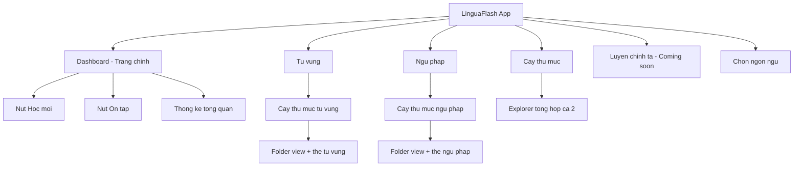
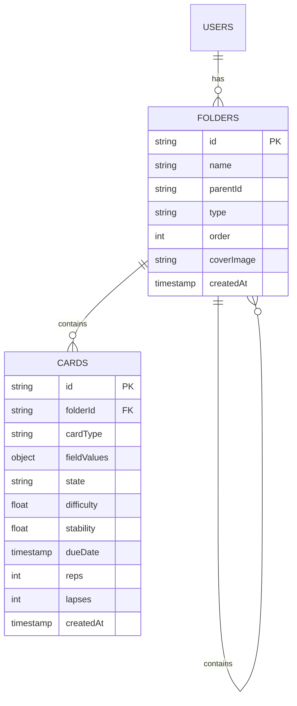
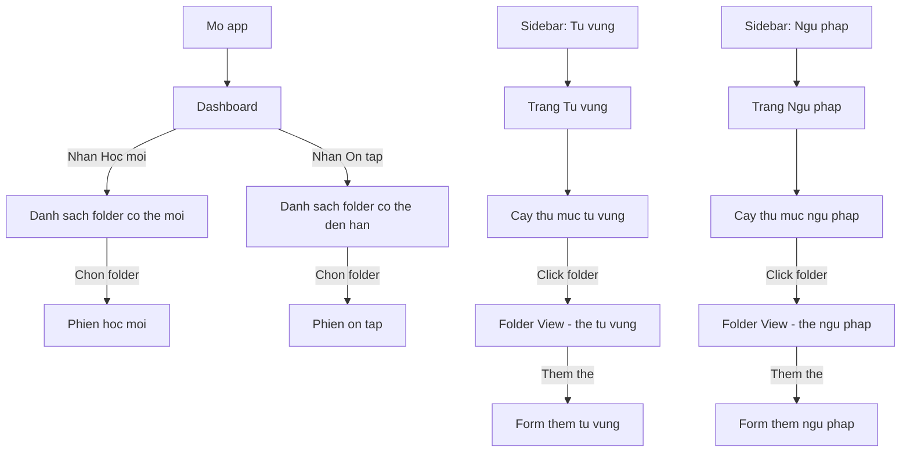

# 📐 Quy hoạch lại bố trí chủ đề, bài học & thẻ học

## 1. Tổng quan thay đổi

### 1.1 Vấn đề hiện tại
- **Home Page** hiện là trang chọn ngôn ngữ (English, Japanese...) → chưa có tác dụng thực tế vì mới chỉ có English
- **Sidebar** chứa quá nhiều mục kỹ thuật: Trường, Hồ sơ cấu hình → gây rối cho người dùng
- **Học mới / Ôn tập** nằm trong sidebar → khó tiếp cận, không nổi bật
- Người dùng phải tự tạo Card Types + Fields → phức tạp, không cần thiết

### 1.2 Hướng mới
- Cấu trúc cố định theo **chủ đề nội dung**: Từ vựng, Ngữ pháp
- Mỗi chủ đề có **cây thư mục riêng** + **thẻ học với fields cố định**
- **Học mới / Ôn tập** đưa ra dashboard chính → truy cập nhanh
- Bỏ hoàn toàn Trường + Hồ sơ cấu hình

---

## 2. Kiến trúc mới

### 2.1 Cấu trúc Navigation



### 2.2 Sidebar mới

| # | Icon | Label | Route | Ghi chú |
|---|------|-------|-------|---------|
| 1 | `menu_book` | Từ vựng | `/vocabulary` | Thay thế Trang chủ |
| 2 | `school` | Ngữ pháp | `/grammar` | Mới |
| 3 | `account_tree` | Cây thư mục | `/folders` | Giữ nguyên |
| 4 | `hearing` | Luyện chính tả | — | Coming soon |
| 5 | `language` | Chọn ngôn ngữ | — | Ở cuối sidebar |

**Bỏ khỏi sidebar:** Trang chủ, Học mới, Ôn tập, Trường, Hồ sơ cấu hình

### 2.3 Dashboard (Trang chính `/`)

Dashboard hiển thị khi mở app hoặc click logo:

```
┌─────────────────────────────────────────┐
│  Chào mừng trở lại! 👋                 │
│  Hôm nay bạn muốn làm gì?             │
├────────────────┬────────────────────────┤
│  🟢 HỌC MỚI   │  🔵 ÔN TẬP           │
│  15 thẻ mới    │  8 thẻ đến hạn        │
│  chưa học      │  cần ôn               │
├────────────────┴────────────────────────┤
│  📊 Thống kê                           │
│  ┌──────┐ ┌──────┐ ┌──────┐ ┌──────┐  │
│  │ 120  │ │  5   │ │  8   │ │  3   │  │
│  │Tổng  │ │Đã học│ │Cần ôn│ │Streak│  │
│  └──────┘ └──────┘ └──────┘ └──────┘  │
└─────────────────────────────────────────┘
```

---

## 3. Data Model - Thẻ với Fields cố định

### 3.1 Thẻ Từ vựng - Vocabulary Card

| Field | Type | Bắt buộc | Mô tả |
|-------|------|----------|-------|
| `word` | text | ✅ | Từ vựng (VD: "abandon") |
| `ipa` | text | ❌ | Phiên âm IPA (VD: "/əˈbæn.dən/") |
| `meaning` | text | ✅ | Nghĩa tiếng Việt (VD: "từ bỏ, bỏ rơi") |
| `example` | textarea | ❌ | Câu ví dụ (VD: "He abandoned his car.") |
| `note` | textarea | ❌ | Ghi chú thêm |

### 3.2 Thẻ Ngữ pháp - Grammar Card

| Field | Type | Bắt buộc | Mô tả |
|-------|------|----------|-------|
| `title` | text | ✅ | Tên cấu trúc (VD: "Present Perfect") |
| `structure` | text | ✅ | Công thức (VD: "S + have/has + V3") |
| `usage` | textarea | ✅ | Cách dùng |
| `example` | textarea | ❌ | Câu ví dụ |
| `note` | textarea | ❌ | Ghi chú thêm |

### 3.3 Firestore Schema thay đổi



**Thay đổi chính:**
- `folders.type` → thêm field mới: `"vocabulary"` hoặc `"grammar"` (phân biệt folder thuộc chủ đề nào)
- `cards.cardType` → thay thế `cardTypeId` bằng string cố định: `"vocabulary"` hoặc `"grammar"`
- `cards.fieldValues` → object chứa giá trị theo fields cố định tương ứng
- **Bỏ hoàn toàn**: collection `cardTypes`, collection `profileFolders`

### 3.4 Ví dụ dữ liệu Card

**Vocabulary card:**
```json
{
  "folderId": "abc123",
  "cardType": "vocabulary",
  "fieldValues": {
    "word": "abandon",
    "ipa": "/əˈbæn.dən/",
    "meaning": "từ bỏ, bỏ rơi",
    "example": "He abandoned his car in the parking lot.",
    "note": "Thường dùng trong IELTS Writing Task 2"
  },
  "state": "new",
  "difficulty": 0,
  "stability": 0,
  "dueDate": null,
  "reps": 0,
  "lapses": 0
}
```

**Grammar card:**
```json
{
  "folderId": "def456",
  "cardType": "grammar",
  "fieldValues": {
    "title": "Present Perfect",
    "structure": "S + have/has + V3/past participle",
    "usage": "Dien ta hanh dong da xay ra trong qua khu nhung co ket qua o hien tai",
    "example": "I have lived in Saigon for 5 years.",
    "note": ""
  },
  "state": "new"
}
```

---

## 4. File Changes - Tổng hợp

### 4.1 Files cần SỬA

| File | Thay đổi |
|------|----------|
| [`sidebar.js`](public/src/js/ui/sidebar.js) | Cập nhật menu items: bỏ Trang chủ/Học mới/Ôn tập/Trường/Hồ sơ, thêm Từ vựng/Ngữ pháp |
| [`app.js`](public/src/js/app.js) | Cập nhật routes: bỏ routes cũ, thêm `/vocabulary`, `/grammar`. Dashboard = `/` |
| [`home.js`](public/src/js/pages/home.js) | Đổi thành Dashboard: 2 nút lớn Học mới/Ôn tập + thống kê |
| [`english.js`](public/src/js/pages/english.js) | Đổi thành `vocabulary.js` - trang Từ vựng với cây thư mục |
| [`folder-view.js`](public/src/js/pages/folder-view.js) | Cập nhật để hiển thị thẻ theo `cardType` với fields cố định |
| [`folder-explorer.js`](public/src/js/pages/folder-explorer.js) | Cập nhật hiển thị cả 2 loại folder |
| [`firestore.js`](public/src/js/db/firestore.js) | Bỏ cardTypes/profileFolders, thêm filter `type` cho folders, cập nhật card schema |
| [`folder-tree.js`](public/src/js/ui/folder-tree.js) | Thêm prop `type` để filter theo vocabulary/grammar |

### 4.2 Files cần TẠO MỚI

| File | Mô tả |
|------|-------|
| `public/src/js/pages/vocabulary.js` | Trang Từ vựng - rename từ english.js |
| `public/src/js/pages/grammar.js` | Trang Ngữ pháp - tương tự vocabulary nhưng cho grammar |
| `public/src/js/config/card-schemas.js` | Định nghĩa fields cố định cho vocabulary + grammar |

### 4.3 Files cần XÓA

| File | Lý do |
|------|-------|
| [`profiles.js`](public/src/js/pages/profiles.js) | Bỏ hồ sơ cấu hình |
| [`profile-editor.js`](public/src/js/pages/profile-editor.js) | Bỏ editor hồ sơ |
| [`profile-folder-view.js`](public/src/js/pages/profile-folder-view.js) | Bỏ folder view hồ sơ |
| [`profile-folder-tree.js`](public/src/js/ui/profile-folder-tree.js) | Bỏ cây thư mục hồ sơ |
| [`fields.js`](public/src/js/pages/fields.js) | Bỏ trang trường |
| [`english.js`](public/src/js/pages/english.js) | Thay bằng vocabulary.js |

### 4.4 Files cần cập nhật HTML

| File | Thay đổi |
|------|----------|
| [`index.html`](public/index.html) | Cập nhật script tags: bỏ files xóa, thêm files mới |

---

## 5. Luồng UX mới

### 5.1 Luồng tổng thể



### 5.2 Dashboard - Học mới flow

```mermaid
flowchart TD
    A[Dashboard - Nhan Hoc moi] --> B[Query cards state = new]
    B --> C[Group theo folderId]
    C --> D[Hien thi flat list folders co the moi]
    D --> E{User chon folder}
    E --> F[Hien thi danh sach the moi trong folder]
    F --> G{Chon the hoac Hoc tat ca}
    G --> H[Bat dau Study Session]
```



---

## 6. Kế hoạch triển khai theo thứ tự

### Step 1: Tạo card-schemas.js
- Định nghĩa VOCABULARY_FIELDS và GRAMMAR_FIELDS
- Export config cho cả 2 loại thẻ

### Step 2: Cập nhật firestore.js
- Bỏ functions liên quan cardTypes, profileFolders
- Thêm parameter `type` cho getFolders, createFolder
- Cập nhật createCard để dùng cardType string thay vì cardTypeId

### Step 3: Cập nhật sidebar.js
- Thay đổi menuItems: bỏ cũ, thêm mới
- Cập nhật _domainRoutes
- Bỏ logic domain detection cũ

### Step 4: Tạo vocabulary.js (từ english.js)
- Rename + cập nhật để dùng folder type = vocabulary
- Cây thư mục chỉ hiển thị folders type vocabulary

### Step 5: Tạo grammar.js
- Tương tự vocabulary nhưng cho grammar
- Cây thư mục chỉ hiển thị folders type grammar

### Step 6: Cập nhật home.js → Dashboard
- Bỏ language domain cards
- Thêm 2 nút lớn Học mới + Ôn tập
- Thêm thống kê tổng quan

### Step 7: Cập nhật folder-view.js
- Hiển thị thẻ theo cardType với fields cố định
- Form thêm/sửa thẻ dùng schema từ card-schemas.js

### Step 8: Cập nhật folder-tree.js
- Thêm prop `type` để filter
- Đảm bảo tạo folder với type đúng

### Step 9: Cập nhật folder-explorer.js
- Hiển thị cả 2 loại folder với icon/label phân biệt

### Step 10: Cập nhật app.js routes
- Bỏ routes: /english, /fields, /profiles, /profiles/:id, /profiles/folder/:id
- Thêm routes: /vocabulary, /grammar

### Step 11: Cập nhật index.html
- Bỏ script tags files xóa
- Thêm script tags files mới

### Step 12: Xóa files không cần
- profiles.js, profile-editor.js, profile-folder-view.js
- profile-folder-tree.js, fields.js, english.js

### Step 13: Cập nhật CSS nếu cần
- Thêm styles cho dashboard buttons
- Cập nhật styles cho form thẻ cố định
