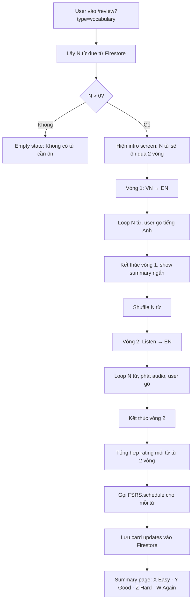

# Review Mode Design - Thiết kế chế độ Ôn tập (Grouped 2-Round)

> 📐 **Quy ước cấp độ ôn tập:** Xem [`plans/review-levels-mapping.md`](review-levels-mapping.md) để hiểu mapping giữa `stepIndex` (0-based, dùng trong code/data) và **"Cấp độ N"** (1-based, hiển thị UI).
> Tóm tắt: `UI = stepIndex + 1`. Bảng các bậc:
> `stepIndex 0 → Cấp độ 1 (30 phút)` · `1 → Cấp độ 2 (1 ngày)` · `2 → Cấp độ 3 (7 ngày)` · `3 → Cấp độ 4 (30 ngày)` · `4 → Cấp độ 5 (90 ngày)`. `stepIndex = -1` = NEW.

## Tổng quan

Chế độ ôn tập bắt buộc người dùng đi qua **cả 2 vòng ôn** cho cùng 1 tập từ:
- **Vòng 1** — Nghĩa tiếng Việt → gõ từ tiếng Anh
- **Vòng 2** — Nghe audio phát âm → gõ từ tiếng Anh

Kết quả 2 vòng được tổng hợp thành 1 FSRS rating duy nhất cho mỗi từ.

---

## 1. Luồng tổng thể



---

## 2. Data Model

### 2.1 Card fields bổ sung (dùng sẵn có từ FSRS)
Không cần thêm field mới cho FSRS. Nhưng cần thêm review history tracking:

```js
card.lastReviewSession: {
    date: "2026-04-16T10:00:00Z",
    round1: { correct: true, attempts: 1, revealed: false },
    round2: { correct: true, attempts: 1, revealed: false },
    finalRating: "good"  // again/hard/good/easy
}
```

### 2.2 Session state (runtime, in-memory)
```js
ReviewSession = {
    cards: [...],              // Danh sách N cards
    currentRound: 1 | 2,       // Vòng hiện tại
    currentIndex: 0,           // Index trong mảng cards
    round1Results: {           // Map cardId → { correct, attempts, revealed }
        "cardId1": { correct: true, attempts: 1, revealed: false },
        ...
    },
    round2Results: {},
    startedAt: timestamp
}
```

---

## 3. UI các màn hình

### 3.1 Intro Screen
```
┌─────────────────────────────────────────┐
│ 🔄 Ôn tập 20 từ                         │
│                                          │
│  Bạn sẽ ôn qua 2 vòng:                  │
│                                          │
│  ① Vòng 1 — Đọc nghĩa tiếng Việt,       │
│     gõ đúng từ tiếng Anh                │
│                                          │
│  ② Vòng 2 — Nghe phát âm,               │
│     gõ đúng từ tiếng Anh                │
│                                          │
│        [Bắt đầu ôn tập] →               │
└─────────────────────────────────────────┘
```

### 3.2 Review Card - Vòng 1 (VN → EN)
```
┌─────────────────────────────────────────┐
│ Vòng 1/2  •  Câu 5/20   ████████░░░░    │
│                                          │
│ ┌──────────────────────────────────────┐ │
│ │  NGHĨA                                │ │
│ │                                       │ │
│ │  từ bỏ, bỏ rơi                        │ │
│ │                                       │ │
│ │  (động từ)                            │ │
│ └──────────────────────────────────────┘ │
│                                          │
│  Gõ từ tiếng Anh:                       │
│  ┌────────────────────────────────────┐ │
│  │ abando█                             │ │
│  └────────────────────────────────────┘ │
│                                          │
│  [💡 Gợi ý]  [👁 Hiện đáp án]  [↵ OK]  │
└─────────────────────────────────────────┘
```

**Hành vi:**
- User gõ → Enter để kiểm tra
- Đúng ngay lần đầu: ✅ xanh, chuyển từ tiếp theo sau 0.8s
- Sai: ❌ đỏ, hiện hint (ký tự đầu) → cho gõ lại
- Nhấn "Hiện đáp án" → tính là fail vòng này, từ chuyển sang từ kế
- Gợi ý: hiện 1 ký tự đầu tiên chưa hiện

### 3.3 Round Summary (giữa vòng 1 và vòng 2)
```
┌─────────────────────────────────────────┐
│ ✅ Hoàn thành Vòng 1                    │
│                                          │
│  Đúng lần đầu:   15/20                  │
│  Cần gợi ý:      4/20                   │
│  Đã bỏ qua:      1/20                   │
│                                          │
│  Tiếp theo: Vòng 2 — Nghe phát âm       │
│                                          │
│           [Bắt đầu Vòng 2] →            │
└─────────────────────────────────────────┘
```

### 3.4 Review Card - Vòng 2 (Listen → EN)
```
┌─────────────────────────────────────────┐
│ Vòng 2/2  •  Câu 3/20   ██░░░░░░░░░░    │
│                                          │
│ ┌──────────────────────────────────────┐ │
│ │                                       │ │
│ │         🔊 [Phát lại âm thanh]       │ │
│ │                                       │ │
│ │         (động từ)                     │ │
│ └──────────────────────────────────────┘ │
│                                          │
│  Gõ từ bạn nghe được:                   │
│  ┌────────────────────────────────────┐ │
│  │                                     │ │
│  └────────────────────────────────────┘ │
│                                          │
│  [🔁 Nghe lại]  [👁 Hiện đáp án]  [↵]   │
└─────────────────────────────────────────┘
```

- Tự động phát audio khi bắt đầu
- User có thể nhấn 🔁 để nghe lại (không tính là sai)

### 3.5 Final Summary
```
┌─────────────────────────────────────────┐
│ 🎉 Hoàn thành ôn tập 20 từ              │
│                                          │
│  😎 Easy:      12 từ                    │
│  😊 Good:       5 từ                    │
│  😐 Hard:       2 từ                    │
│  😓 Again:      1 từ                    │
│                                          │
│  Tổng thời gian: 5 phút 23 giây         │
│                                          │
│    [Về trang chủ]  [Ôn tiếp]            │
└─────────────────────────────────────────┘
```

---

## 4. Logic tổng hợp FSRS Rating

### Ma trận ánh xạ

| R1 Outcome | R2 Outcome | Final Rating |
|---|---|---|
| ✅ Đúng lần đầu | ✅ Đúng lần đầu | **4 — Easy** |
| ✅ Đúng lần đầu | ⚠️ Cần gợi ý | **3 — Good** |
| ⚠️ Cần gợi ý | ✅ Đúng lần đầu | **3 — Good** |
| ⚠️ Cần gợi ý | ⚠️ Cần gợi ý | **2 — Hard** |
| ✅/⚠️ | ❌ Reveal/skip | **1 — Again** |
| ❌ Reveal/skip | ✅/⚠️/❌ | **1 — Again** |

### Rule chi tiết
```js
function computeFinalRating(r1, r2) {
    // Nếu bất kỳ vòng nào phải xem đáp án → Again
    if (r1.revealed || r2.revealed) return 1;

    // Cả 2 vòng đúng ngay lần đầu
    if (r1.attempts === 1 && r2.attempts === 1) return 4;

    // Có 1 vòng cần gợi ý
    if (r1.attempts > 1 && r2.attempts > 1) return 2; // cả 2 đều cần
    return 3; // 1 trong 2 cần
}
```

---

## 5. Text-to-Speech (TTS)

### Web Speech API (default)
```js
function speak(word) {
    const utterance = new SpeechSynthesisUtterance(word);
    utterance.lang = 'en-US';
    utterance.rate = 0.9;
    speechSynthesis.speak(utterance);
}
```

### Fallback
Nếu `speechSynthesis` không khả dụng → vòng 2 chuyển sang chế độ dự phòng:
- Hiện phiên âm IPA + từ loại (che nghĩa tiếng Việt)
- User vẫn phải gõ từ

---

## 6. Kiểm tra câu trả lời

### Normalize input
```js
function normalize(str) {
    return str.trim().toLowerCase()
        .replace(/\s+/g, ' ');
}

function isCorrect(userInput, expected) {
    return normalize(userInput) === normalize(expected);
}
```

### Hint system
- Lần sai thứ 1: hiện ký tự đầu
- Lần sai thứ 2: hiện 30% ký tự đầu
- Lần sai thứ 3: auto reveal → coi như fail

---

## 7. Components / Files cần tạo

| File | Vai trò |
|---|---|
| `public/src/js/pages/review.js` | Page controller + routing |
| `public/src/js/review/review-session.js` | Session state manager |
| `public/src/js/review/review-ui.js` | Render UI từng màn hình |
| `public/src/js/utils/tts.js` | Wrapper Web Speech API |
| `public/src/css/components.css` | CSS cho review screens |

---

## 8. FSRS Integration

### Flow cập nhật
```js
// Sau khi hoàn thành 2 vòng
for (const card of session.cards) {
    const r1 = session.round1Results[card.id];
    const r2 = session.round2Results[card.id];
    const rating = computeFinalRating(r1, r2);

    // FSRS.schedule trả về card mới với dueDate, stability, difficulty updated
    const updatedCard = FSRS.schedule(card, rating);

    // Lưu lịch sử
    updatedCard.lastReviewSession = {
        date: new Date().toISOString(),
        round1: r1,
        round2: r2,
        finalRating: ['', 'again', 'hard', 'good', 'easy'][rating]
    };

    await FirestoreDB.updateCard(card.id, updatedCard);
}
```

---

## 9. Todo list triển khai

1. Tạo utility TTS wrapper (`tts.js`)
2. Tạo ReviewSession module - quản lý state 2 vòng
3. Tạo Review UI - Intro screen
4. Tạo Review UI - Card vòng 1 (VN → EN)
5. Tạo Review UI - Round summary
6. Tạo Review UI - Card vòng 2 (Listen → EN)
7. Tạo Review UI - Final summary
8. Logic tổng hợp rating + gọi FSRS
9. Lưu kết quả vào Firestore
10. CSS cho toàn bộ review screens
11. Handle edge cases: không có từ due, offline, TTS fail
12. Tích hợp với Family Word Manager (nếu từ vừa ôn có familyId → update pending)

---

## 10. Edge Cases

| Case | Xử lý |
|---|---|
| Không có từ due | Empty state với CTA "Học thêm từ mới" |
| TTS không khả dụng | Vòng 2 fallback hiện IPA + partOfSpeech |
| User refresh giữa chừng | Lưu session state vào sessionStorage, hỏi "Tiếp tục phiên cũ?" |
| User đóng tab | Cards chưa finalize → giữ nguyên state cũ, chưa gọi FSRS |
| Network fail khi save | Lưu pending vào localStorage, sync sau |
| Card có familyId | Sau khi complete → gọi FamilyWordManager.onWordLearned |
