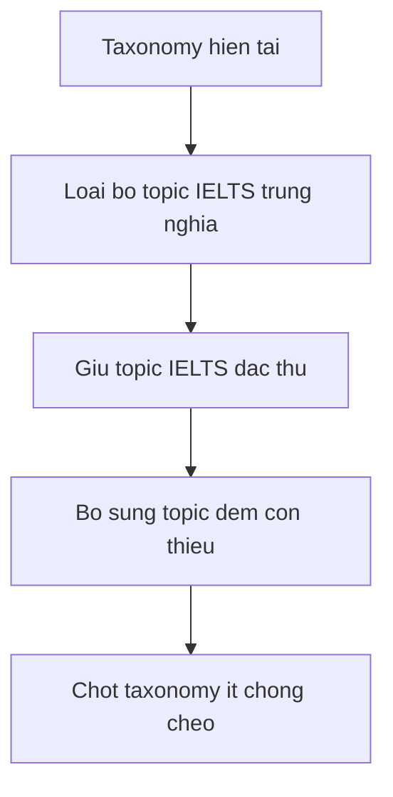

# Kế hoạch tái cấu trúc taxonomy topic

## Mục tiêu

Tái thiết kế taxonomy trong [`public/src/js/config/vocabulary-topics.js`](../public/src/js/config/vocabulary-topics.js) theo hướng:

- phân loại học thuật hơn
- giảm chồng chéo giữa các topic
- giữ lại topic IELTS chỉ khi thật sự đặc thù
- tạo đủ topic đệm để chứa từ vựng nền, từ vựng rộng nghĩa và family words mà không phải nhét ép

## Nhận định hiện trạng

### Các vùng đang chồng chéo

1. [`travel`](../public/src/js/config/vocabulary-topics.js) và [`travel-tourism`](../public/src/js/config/vocabulary-topics.js)
   - trùng lõi nghĩa rất mạnh
   - khác biệt chỉ là cách đặt tên phổ thông và IELTS

2. [`arts`](../public/src/js/config/vocabulary-topics.js) và [`arts-literature`](../public/src/js/config/vocabulary-topics.js)
   - phần `arts` bị lặp
   - `literature` là nhánh riêng, không nên gộp bằng tên song đôi

3. [`sports`](../public/src/js/config/vocabulary-topics.js) và [`sports-games`](../public/src/js/config/vocabulary-topics.js)
   - chồng chéo trực tiếp ở lớp nghĩa sports
   - `games` có thể là nhánh phụ, không cần topic song song nếu mục tiêu là taxonomy sạch

4. [`culture`](../public/src/js/config/vocabulary-topics.js) và [`cultural-differences`](../public/src/js/config/vocabulary-topics.js)
   - topic IELTS này thực chất là tiểu miền của culture
   - không đủ đặc thù để đứng riêng lâu dài

5. [`music-entertainment`](../public/src/js/config/vocabulary-topics.js) giao thoa với [`arts`](../public/src/js/config/vocabulary-topics.js) và [`culture`](../public/src/js/config/vocabulary-topics.js)
   - nếu giữ, phải định nghĩa là media-entertainment
   - nếu không, dễ đè lên arts

6. [`personal-qualities`](../public/src/js/config/vocabulary-topics.js), [`psychology`](../public/src/js/config/vocabulary-topics.js), [`communication-social`](../public/src/js/config/vocabulary-topics.js)
   - ba topic này sát nhau nhưng vẫn tách được nếu định nghĩa ranh giới rõ

## Nguyên tắc tái cấu trúc

- Một topic chỉ nên đại diện cho một lớp nghĩa chính.
- Không giữ đồng thời topic thường và topic IELTS nếu chúng cùng nói về một miền nghĩa.
- Topic IELTS chỉ giữ nếu nó phản ánh một domain riêng, không phải chỉ là biến thể tên gọi.
- Topic đệm nên có nhưng phải có ranh giới rõ, tránh trở thành thùng rác ngữ nghĩa.

## Đề xuất taxonomy đích

### Nhóm Xã hội và đời sống

Giữ:
- `family-relationships`
- `daily-life`
- `personal-qualities`
- `daily-activities`
- `communication-social`
- `health`
- `education`
- `psychology`
- `culture`
- `arts`
- `sports`
- `travel`

Thêm mới:
- `food-drink`
- `home-living`
- `emotion-feelings`

Lý do:
- [`good`](../data/seed-vocabulary/test-samples.json) và nhiều từ nền có chỗ đứng trong [`daily-life`](../public/src/js/config/vocabulary-topics.js)
- từ về tính cách như kind, honest, generous đi vào [`personal-qualities`](../public/src/js/config/vocabulary-topics.js)
- từ về cảm xúc như sadness, anxious, delighted nên tách khỏi [`psychology`](../public/src/js/config/vocabulary-topics.js) để tránh lẫn giữa trạng thái cảm xúc và khái niệm tâm lý
- từ về ăn uống và sinh hoạt gia đình rất khó nhét sạch nếu thiếu [`food-drink`](../public/src/js/config/vocabulary-topics.js) và [`home-living`](../public/src/js/config/vocabulary-topics.js)

### Nhóm Kinh tế và pháp luật

Giữ:
- `economy`
- `finance`
- `investment`
- `business`
- `law`
- `crime`
- `politics`
- `employment`
- `urbanization`

Nhận xét:
- nhóm này hiện khá ổn
- chưa cần sáp nhập ngay vì các lớp nghĩa đã tương đối rõ

### Nhóm Khoa học và công nghệ

Giữ:
- `environment-climate`
- `energy-resources`
- `science`
- `information-technology`
- `space`

Nhận xét:
- đủ rõ lớp nghĩa
- về sau có thể cân nhắc tách `medicine-health-science` nếu dữ liệu chuyên sâu hơn, nhưng hiện chưa cần

### Nhóm IELTS đặc thù

Giữ lại có chọn lọc:
- `history-archeology`

Đổi tên để rõ hơn:
- `music-entertainment` → `media-entertainment`

Sáp nhập vào taxonomy chung:
- `travel-tourism` → nhập vào `travel`
- `arts-literature` → tách nghĩa, nhập phần arts vào `arts`, đồng thời thêm topic mới `literature-reading`
- `sports-games` → nhập vào `sports`
- `cultural-differences` → nhập vào `culture`

Lý do:
- [`history-archeology`](../public/src/js/config/vocabulary-topics.js) là một domain khá đặc thù, đáng giữ
- `music-entertainment` nếu chỉ là music thì chồng với arts, nhưng nếu đổi thành media-entertainment thì có ranh giới riêng hơn
- literature là lớp nghĩa đủ độc lập để đứng riêng, tốt hơn nhiều so với ghép trong arts-literature

### Nhóm ngôn ngữ đặc biệt

Giữ:
- `idioms`
- `irregular-verb-v1`
- `irregular-verb-v2`
- `irregular-verb-v3`
- `irregular-adj-comparative`
- `irregular-adj-superlative`

## Danh sách thay đổi đề xuất

### Thêm topic
- `food-drink`
- `home-living`
- `emotion-feelings`
- `literature-reading`
- `media-entertainment`

### Đổi tên topic
- `music-entertainment` thành `media-entertainment`

### Sáp nhập topic
- `travel-tourism` vào `travel`
- `sports-games` vào `sports`
- `cultural-differences` vào `culture`
- `arts-literature` bỏ cấu trúc ghép, phân bổ vào `arts` và `literature-reading`

### Giữ nguyên
- toàn bộ nhóm business
- toàn bộ nhóm science
- nhóm irregular
- `idioms`
- `history-archeology`

## Ranh giới ngữ nghĩa cốt lõi

- `daily-life`: từ nền tảng, đời sống thường nhật, tính từ rộng nghĩa, đồ vật và khái niệm sinh hoạt chung
- `daily-activities`: hành động, thói quen, routine, việc làm lặp lại hằng ngày
- `personal-qualities`: phẩm chất, tính cách, đặc điểm đạo đức hoặc đánh giá cá nhân bền vững
- `emotion-feelings`: cảm xúc và trạng thái tình cảm
- `psychology`: khái niệm tâm lý, nhận thức, hành vi tinh thần, quá trình tư duy
- `communication-social`: tương tác xã hội, hội thoại, tranh luận, biểu đạt, phép xã giao
- `culture`: chuẩn mực, phong tục, bản sắc, khác biệt văn hóa
- `arts`: mỹ thuật, nghệ thuật tạo hình, sáng tạo thẩm mỹ nói chung
- `literature-reading`: sách, tác phẩm, đọc hiểu, tác giả, thể loại văn học
- `media-entertainment`: âm nhạc, điện ảnh, truyền hình, biểu diễn đại chúng, giải trí truyền thông
- `travel`: di chuyển, chuyến đi, du lịch, phương tiện phục vụ đi lại và trải nghiệm lữ hành
- `home-living`: nhà cửa, không gian sống, vật dụng gia đình, sinh hoạt trong nhà
- `food-drink`: đồ ăn, đồ uống, nấu nướng, khẩu vị, dinh dưỡng cơ bản

## Mermaid tổng quan

## Kế hoạch triển khai sau khi chốt

1. cập nhật danh sách topic trong [`public/src/js/config/vocabulary-topics.js`](../public/src/js/config/vocabulary-topics.js)
2. rà soát mapping seed hiện có sang topic mới
3. lập quy tắc di chuyển seed cho các topic bị sáp nhập
4. kiểm tra lại filter, thống kê topic và auto-seed
5. sau đó mới xử lý cleanup Firestore lệch seed